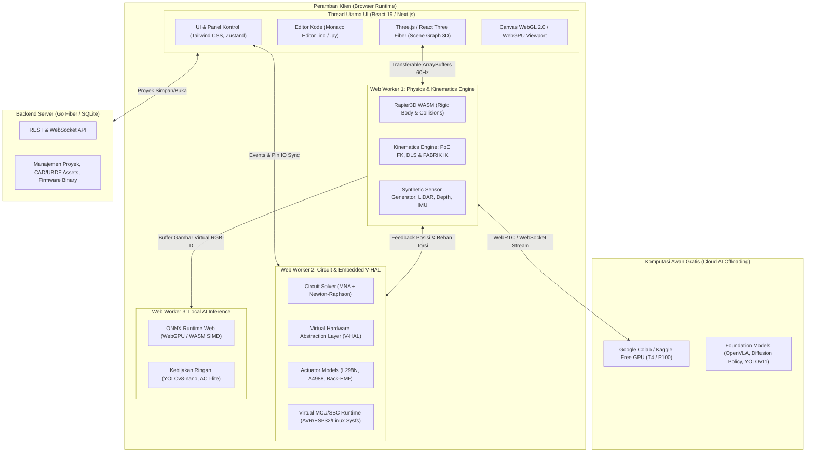

# Architecture Design Document (ADD)
## Arsitektur Sistem Platform Simulasi 3D Physical AI & Robotika

- **Kode Proyek**: `TridiArduSim-PhysicalAI`
- **Versi Dokumen**: 1.1.0 (revisi 4 Oktober 2026 — koreksi klaim engine, latensi, & scope sandbox; detail di README)
- **Status**: Disetujui untuk Desain Sistem
- **Terkait dengan**: [01-PRD-PHYSICAL-AI-ROBOTICS.md](file:///Users/user/Projects/simulate/docs/01-PRD-PHYSICAL-AI-ROBOTICS.md)

---

## 1. Ikhtisar Arsitektur (Architectural Overview)

Platform ini dirancang dengan pendekatan **Web-First, High-Performance, Multi-Threaded Architecture**. Untuk memastikan rendering 3D tetap mencapai 60 FPS di laptop berspesifikasi standar tanpa mengalami *jank* (pembekuan UI), komputasi berat dipisahkan ke dalam beberapa lapisan thread Web Worker yang berkomunikasi secara asinkron menggunakan protokol data biner efisien (*Transferable Objects / SharedArrayBuffer*).



---

## 2. Dekomposisi Subsistem (Subsystem Decomposition)

### 2.1 Subsistem 1: 3D Scene & Rendering Pipeline (Main Thread)
- **Teknologi**: Next.js 16, React 19, `@react-three/fiber` 9, `@react-three/drei` 10, Three.js `r184`.
- **Fungsi Utama**:
  - Mengelola Scene Graph 3D: Lengan robot, sasis mobile robot, breadboard, mikrokontroler, modul sirkuit, dan perkabelan interaktif.
  - Material Fisik Berbasis PBR (*Physically Based Rendering*): Visualisasi realistis untuk komponen elektronik (FR-4 PCB, pad tembaga, solder timah mengkilap, insulasi silikon kabel, bodi aluminium stepper motor NEMA 17).
  - **RGB-D yang tersedia saat ini**: `THREE.WebGLRenderTarget` menghasilkan frame RGBA dan pass shader mengemas depth view-space ke 24-bit RGB, lalu diekspansi menjadi `Float32Array` meter di CPU. Resolusi 320×240 atau 640×480; intrinsics dihitung dari FOV; sampling 10 Hz sim-time. Snapshot dikirim dengan structured clone ke simulation worker saat signature frame berubah; sequence capture monotonik mempertahankan frame baru yang dipicu perubahan pose pada timestamp sim-time yang sama. Sketch membaca piksel lewat shim numerik. V-SBC menerima frame RGBA terbaru sebagai structured clone; belum memakai attachment Float32/HalfFloat atau zero-copy, dan GPU readback tetap sinkron.
  - **LiDAR yang tersedia saat ini**: raycast Three.js pada scene untuk scan planar 360° dengan 360 atau 720 sampel dan jarak maksimum yang dapat diatur, sampling 10 Hz sim-time. Scan dikirim ke simulation worker saat signature frame berubah; sketch membaca range/hit per indeks. `three-mesh-bvh` belum dipasang dan performa scene kompleks belum diukur.

### 2.2 Subsistem 2: Physics & Kinematics Engine (Worker Thread 1)
- **Teknologi**: Rust dikompilasi ke WebAssembly (`@dimforge/rapier3d-compat`), SIMD acceleration.
- **Fungsi Utama**:
  - **Tersedia tahap awal**: dedicated physics worker menginisialisasi Rapier secara lazy saat ada body fisika, menerima batch jumlah langkah dari circuit worker, dan menjalankan fixed `dt=5 ms` yang berhenti saat pause. Dimensi scene dikonversi 1 unit = 5 mm (referensi envelope breadboard 84 mm / 16.8 unit). Komponen opt-in sebagai `dynamic` atau `fixed`; collider menggunakan kotak dari conservative local bounds, material menerima massa, friction dan restitution, serta ada lantai meja. Transform dinamis kembali ke R3F lewat `Float32Array` hingga sekitar 60 Hz. Bodi default off agar komponen wiring tidak ikut jatuh.
  - **Constraint tahap awal**: pasangan body dapat dihubungkan dengan `fixed`, `revolute` (sumbu lokal Y), atau `prismatic` (sumbu lokal Y) melalui inspector. Parent harus aktif sebagai fixed/dynamic body. Ini constraint pasif; belum ada UI anchor/axis custom, limit/motor joint, assembly URDF, collider mengikuti mesh, shape collider spesifik, atau profil massa/inersia dan CoM per komponen.
  - **Batas model**: orientasi dan contact solve ditangani Rapier, tetapi world bounds box bersifat kasar dan hanya body yang diaktifkan pengguna berinteraksi (selain lantai). Grid scene masih model visual; tidak ada dynamic body langsung untuk joint-link robot. Worker menggunakan build `@dimforge/rapier3d-compat` dengan WASM terbenam untuk bundler.
  - **Kinematika Robot Modern**:
    - Perhitungan Forward Kinematics (FK) berbasis Product of Exponentials (PoE).
    - Perhitungan Inverse Kinematics (IK) berbasis Damped Least Squares (DLS) dan FABRIK.
  - **Sensor Sintetis**: RGB-D, LiDAR planar, dan IMU dihitung pada thread renderer UI, bukan Physics Worker pada diagram. Frame RGB-D, range/hit LiDAR, dan 6-axis IMU diteruskan ke simulation worker sebagai snapshot terbaru; sequence RGB-D memastikan perubahan pose di timestamp sama tetap dianggap frame baru. Sketch Arduino dapat membaca nilai melalui `cameraDepth(id,x,y)`, `cameraRgb(id,x,y,channel)`, `lidarRange(id,index)`, `lidarHit(id,index)`, dan `imuRead(id,axis)`. Snapshot IMU juga dapat dibaca lewat register MPU-6050 virtual di I2C `0x68` jika SDA/SCL terhubung dan modul menyala. Preset `sensor_fusion` menyediakan Uno dan ketiga sensor tanpa wiring untuk mencoba pembacaan shim Serial. V-SBC Python dapat membaca frame RGB-D melalui `cv2.VideoCapture(0)`; V4L2 `/dev/video0`, zero-copy framebuffer, sensor pada Rapier body dan IMU bias drift belum tersedia. Physics worker rigid-body dasar tersedia sebagai jalur terpisah.

### 2.3 Subsistem 3: Circuit & Virtual Embedded V-HAL (Worker Thread 2)
- **Teknologi**: TypeScript. **Koreksi v1.0**: (a) **tidak memakai AVR8js** — engine MCU existing adalah interpreter subset .ino kustom (parser mandiri, tanpa `eval`/`new Function`); (b) **bukan** "MNA Engine" — solver existing adalah nodal DC kuasistatik.
- **Fungsi Utama**:
  - **Arsitektur Hybrid (pengganti klaim "MNA dinamis" v1.0)**: Sirkuit kontrol tetap disolve solver DC kuasistatik existing (Gaussian elimination, ≤256 net, tick 25 Hz → migrasi ke sim clock M0). Aktuator (motor DC, driver, baterai) berjalan sebagai **model stateful terpisah (LTI)** yang diintegrasikan per timestep sim clock, dan dikopling ke solver lewat tegangan/arus pada terminal V-HAL. Alasan: PWM + induktansi kumparan + komutasi dioda flyback membentuk ODE stiff dengan event switching; MNA transien penuh adalah tulis-ulang besar yang tidak proporsional untuk target edukasi, dan model LTI per-aktuator memberikan perilaku yang sama untuk kasus yang didukung.
  - **Model Driver Aktuator**:
    - Driver H-Bridge L298N (transistor saturasi bipolar, dioda flyback proteksi).
    - Driver Stepper A4988/DRV8825 (generator pulsa STEP/DIR, microstepping sinusoidal hingga 1/32 langkah).
  - **Dinamika Elektromekanik**: Mengaitkan arus sirkuit dengan torsi mekanik ($T = K_t \cdot I$) dan kecepatan putar dengan gaya gerak listrik balik ($V_{emf} = K_e \cdot \omega$).
  - **Virtual Hardware Abstraction Layer (V-HAL)**:
    - Mensimulasikan register pin I/O, counter PWM, ADC 10/12-bit, dan interupsi eksternal.
    - Menghubungkan pin mikrokontroler virtual secara langsung ke logika driver dan sendi fisik simulator.
    - **Fondasi M0 tersedia**: handle `Servo` sketch menyimpan state terpisah per objek dan `attach(pin)` menemukan SG90 melalui wire, jumper, kontak kaki-komponen, dan breadboard net. `analogWriteResolution(bits)` mengkuantisasi PWM 1–8 bit pada Uno dan 1–16 bit pada ESP32 (default 8 bit); solver DC memakai tegangan rata-rata duty pada timestep 5 ms. Encoder menghasilkan count x4 dan level Gray-code A/B dari sudut poros, dapat dikopel 1:1 ke NEMA17, dan memicu callback `attachInterrupt` pada edge GPIO (Uno D2/D3; ESP32 GPIO valid); ISR belum cycle-accurate dan dibatasi 256 transisi per update motor. A4988 membaca STEP/DIR/ENABLE/MS1–MS3/RESET/SLEEP dari net listrik, menerima STEP falling-edge minimal 1 µs, dan mengatur arus koil dengan formula Vref/(8Rs) pada model kuasistatik sampai microstep 1/16. UVLO, OCP setpoint, dan estimasi termal RC disertakan, tetapi bukan chopping PWM atau short terminal aktual. Driver dan catu DC ideal dapat dipasang melalui rangkaian ke NEMA17; catu belum memiliki limit arus/sag. Sudut Servo/Stepper sekarang dapat dipetakan ke joint arm dengan offset, arah, serta joint limit; mesh mounting, torsi, dan respons actuator-joint dinamis belum ada.
    - **Elektronika daya awal tersedia**: L298N membaca EN/PWM dan arah dari net, menerapkan drop nominal 2 V, melaporkan arus/rugi daya, membebani sumber VS, memiliki dioda clamp flyback dan heatsink RC dengan shutdown/recovery. Motor DC memakai cabang R-L/back-EMF dan integrasi putaran fixed-step 5 ms. Battery pack memakai kurva OCV/ESR/SoC, proteksi overcurrent pelepasan, dan menangkap beban servo/A4988/L298N/regulator buck-boost; charger CC/CV edukasi mengisi Li-ion 1S/LiPo 2S dengan SoC per sel, passive balancing dan timer keselamatan berbasis sim-time, blok polaritas, serta shutdown termal RC. Converter buck-boost menjaga rail 3.3/5/9/12 V dengan batas arus kuasistatik. Monitor BOR menahan dan mengulang sketch saat rail board pulih. Parameter charger edukasional dan proteksi polaritas masih ideal, belum divalidasi terhadap hardware. Chopper PWM cycle-accurate, limit arus catu, regulator onboard MCU, reverse current/regenerasi, dan validasi hardware masih belum ada.
    - **Differential drive P0 tersedia**: `RoverBot-4WD` mengintegrasikan wheel speed, wheel phase, posisi, dan heading pada sim-time fixed step. Panel menyediakan kontrol dan gimbal; shim interpreter `DifferentialDrive.drive(left, right)`/`stop()` mengendalikan RoverBot dari sketch. Pergerakan diferensial masih model kinematika roda terpisah; body Rapier generik dapat diaktifkan untuk collision/gravity, tetapi kecepatan roda belum mendorong dinamika sasis atau menciptakan gaya kontak.

### 2.4 Subsistem 4: Hybrid AI Gateway & Virtual SBC (Python Worker / Cloud Bridge)
- **Teknologi**: Pyodide pada dedicated worker; browser WebSocket client untuk action-chunk gateway; ONNX Runtime Web pada dedicated worker dengan WebGPU dan fallback WASM.
- **Fungsi Utama**:
  - **In-Browser Inference (Tingkat Lokal)**: panel menerima file ONNX lokal maksimum 100 MB dan menjalankan satu tensor input RGB Float32 rank-4 NCHW/NHWC dengan batch 1. Dimensi dinamis dapat dipilih (16–1024 px); dukungan backend mencoba WebGPU lalu fallback ke WASM SIMD. Kamera, ukuran input dan normalisasi unit/ImageNet dapat dipilih. Saat ini hanya output skor kelas Float32 yang dirangking; deteksi, output multi-tensor, label bawaan, metadata/preprocessing model khusus dan E2E browser belum didukung/diverifikasi. WASM runtime disajikan dari `/onnxruntime/`, model tetap di browser.
  - **Cloud Offloading Bridge (Tingkat Foundation Model)**:
    - **Tersedia tahap awal**: panel mengirim JPEG kamera QVGA maksimum 320×240, sequence, sim-time, ID kamera, dan posisi joint robot terpilih melalui WebSocket `wss://` pada 5/10 Hz. Balasan `action_chunk` berisi target posisi joint radian; UI memvalidasi ukuran/sequence/robot/index, clamp joint limit, lalu menginterpolasi posisi memakai simulation time. `ws://` hanya diterima untuk localhost. Notebook starter Colab/ngrok memberi server contoh dengan kebijakan hold posisi.
    - **Belum tersedia**: inferensi VLA/ACT/Diffusion Policy nyata, Kaggle template, WebRTC, manajemen token, atau observability end-to-end. **Koreksi v1.1**: skema targetnya asynchronous action-chunk 5–10 Hz, bukan closed-loop real-time; latensi browser-cloud realistis 60–150 ms — lihat doc 05 §4.1.
  - **Virtual SBC Layer (subset yang dideklarasikan — koreksi v1.0)**:
    - **Tersedia di kode**: file `.py` berjalan pada worker Pyodide terpisah; NumPy dan paket `opencv-python` WASM Pyodide menyediakan API `cv2`; `Jetson.GPIO` menyediakan mode BCM, setup/input/output, PWM, cleanup; `cv2.VideoCapture(0)` membaca RGBA terbaru dari render target RGB-D dan mengembalikan frame BGR top-left. Worker sirkuit terpisah menerapkan GPIO ke pin Uno/ESP32 yang dipilih pengguna. `for`/`while` dan `time.sleep()` mendapat cooperative yield supaya pause berfungsi; stop mengakhiri worker Python.
    - Loader, runtime core Pyodide WASM, stdlib, dan lockfile disalin lokal oleh lifecycle script npm. Wheel NumPy/OpenCV dimuat sesuai lockfile dari CDN resmi jsDelivr saat pertama dijalankan; runtime Python karena itu membutuhkan jaringan pada first run atau cache browser yang tersedia. Pyodide dipatok ke versi pada `pyodideVersion.ts`.
    - **Di luar scope**: `rclpy`/ROS 2, filesystem Linux, driver perangkat, threading OS, `GPIO.BOARD`, dan V4L2. Kode pengguna yang hanya memakai API subset ini ditujukan agar mudah dipindahkan ke Jetson/Raspberry Pi fisik; kesetaraan perilaku hardware belum divalidasi.
    - **Di luar scope**: `rclpy`/ROS 2, filesystem Linux, driver perangkat, threading OS. Klaim v1.0 "100% kompatibel dengan perangkat fisik" ditarik. Daftar subset dipublikasikan di UI dan doc 05 §3.

---

## 3. Desain Komunikasi Data & Sinkronisasi (Data Flow & Synchronization)

Untuk mencegah bottleneck serialisasi JSON pada 60 Hz, data posisi sendi dan tegangan listrik dialirkan menggunakan **ArrayBuffer Biner Bertipe (Typed Arrays)**:

```
[Float32Array Layout: State Sinkronisasi 60Hz]
Offset 0x00 - 0x17 : Pose End-Effector [X, Y, Z, Qx, Qy, Qz, Qw] (Float32 x 7)
Offset 0x1C - 0x33 : Sudut Aktual Sendi Robot Joint 1-6 (Float32 x 6)
Offset 0x34 - 0x4B : Torsi Beban Sendi Joint 1-6 (Float32 x 6)
Offset 0x4C - 0x57 : Sensor Sintetis IMU [AccX, AccY, AccZ, GyroX, GyroY, GyroZ] (Float32 x 6)
Offset 0x58 - 0x67 : Tegangan Rail Catu Daya [V_5V, V_3V3, V_Bat, I_Total] (Float32 x 4)
```

Dengan struktur biner tetap ini, thread utama dan worker thread hanya bertukar memori biner tanpa alokasi garbage collection berulang, menjamin stabilitas framerate rendering bahkan pada peramban mobile/laptop hemat daya.

**Sim Clock & Fixed Timestep (M0)**: worker memiliki satu jam simulasi fixed-step 5 ms (200 Hz); state dikirim ke UI paling sering setiap 16.667 ms (~60 Hz). `millis()`/`micros()`, `delay()`/`delayMicroseconds()`, dan timer Wi-Fi virtual memakai sim-time. Waktu hanya maju per tick simulasi dan berhenti saat pause, sehingga tidak dipengaruhi waktu dinding atau throttling browser. Ini prasyarat replay dan pengujian deterministik. Integrasi fisika/aktuator per tick akan memakai jam yang sama saat subsistem tersebut diimplementasikan.

---

## 4. Keamanan & Isolasi Lingkungan Eksekusi (Sandboxing)

1. **Isolasi Kode Pengguna**:
   - Kode Arduino C++ (.ino) dan script Python dijalankan dalam Web Worker terisolasi.
   - Script pengguna tidak memiliki akses langsung ke objek DOM `window` atau `document`, mencegah kerentanan XSS (Cross-Site Scripting).
2. **Batas Sumber Daya (Resource Guarding)**:
   - Pembatas siklus operasi (Watchdog Timer): Jika loop pengguna macet (*infinite loop* tanpa jeda), worker otomatis dihentikan setelah interval 500 ms dan menampilkan peringatan yang ramah.
   - Batas buffer memori: Aliran serial dibatasi maksimal 64 KB, dan buffer gambar virtual dibatasi resolusi QVGA/VGA (320x240 atau 640x480) untuk menghemat bandwidth transmisi AI.
3. **Akses Jaringan**: sketch dan Python worker tidak boleh memicu request internet; API kompatibilitas `httpGet`/`http.get` mengembalikan status `0`. Async AI Gateway dibuka secara eksplisit oleh pengguna melalui panel; koneksi remote mewajibkan `wss://`, sedangkan `ws://` hanya untuk localhost. Gateway mengirim frame JPEG dan posisi joint robot terpilih, bukan kode sketch/proyek, wiring, atau token tunnel. WebSocket remote belum memiliki domain allow-list maupun autentikasi protokol; gunakan endpoint tepercaya dan jangan menaruh kredensial di URL.
