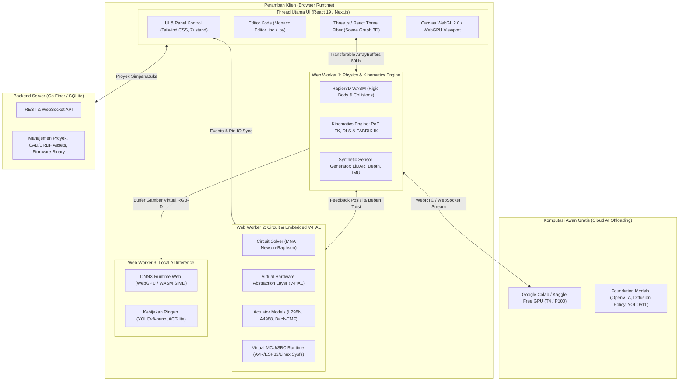

# Architecture Design Document (ADD)
## Arsitektur Sistem Platform Simulasi 3D Physical AI & Robotika

- **Kode Proyek**: `TridiArduSim-PhysicalAI`
- **Versi Dokumen**: 1.0.0
- **Status**: Disetujui untuk Desain Sistem
- **Terkait dengan**: [01-PRD-PHYSICAL-AI-ROBOTICS.md](file:///Users/user/Projects/simulate/docs/01-PRD-PHYSICAL-AI-ROBOTICS.md)

---

## 1. Ikhtisar Arsitektur (Architectural Overview)

Platform ini dirancang dengan pendekatan **Web-First, High-Performance, Multi-Threaded Architecture**. Untuk memastikan rendering 3D tetap mencapai 60 FPS di laptop berspesifikasi standar tanpa mengalami *jank* (pembekuan UI), komputasi berat dipisahkan ke dalam beberapa lapisan thread Web Worker yang berkomunikasi secara asinkron menggunakan protokol data biner efisien (*Transferable Objects / SharedArrayBuffer*).



---

## 2. Dekomposisi Subsistem (Subsystem Decomposition)

### 2.1 Subsistem 1: 3D Scene & Rendering Pipeline (Main Thread)
- **Teknologi**: Next.js 16, React 19, `@react-three/fiber` 9, `@react-three/drei` 10, Three.js `r184`.
- **Fungsi Utama**:
  - Mengelola Scene Graph 3D: Lengan robot, sasis mobile robot, breadboard, mikrokontroler, modul sirkuit, dan perkabelan interaktif.
  - Material Fisik Berbasis PBR (*Physically Based Rendering*): Visualisasi realistis untuk komponen elektronik (FR-4 PCB, pad tembaga, solder timah mengkilap, insulasi silikon kabel, bodi aluminium stepper motor NEMA 17).
  - Kamera Sintetis Rendering: Menggunakan `THREE.WebGLRenderTarget` dengan format `THREE.FloatType` atau `THREE.HalfFloatType` untuk mengekstrak kedalaman (*Depth Buffer*) dan matriks intrinsik kamera ($f_x, f_y, c_x, c_y$).
  - Raycasting Cepat via `three-mesh-bvh`: Mempercepat kalkulasi interaksi klik mouse dan deteksi LiDAR hingga 100.000 ray/detik pada mesh kompleks.

### 2.2 Subsistem 2: Physics & Kinematics Engine (Worker Thread 1)
- **Teknologi**: Rust dikompilasi ke WebAssembly (`@dimforge/rapier3d-compat`), SIMD acceleration.
- **Fungsi Utama**:
  - **Dinamika Benda Kaku (*Rigid Body Dynamics*)**: Mengkalkulasi inersia massa, pusat massa (*Center of Mass / CoM*), gesekan permukaan statis/dinamis, dan pantulan (*restitution*).
  - **Sambungan Multi-Sendi (*Joint Constraints*)**:
    - *Revolute Joint* (Sendi putar pada servo, stepper, engsel robot).
    - *Prismatic Joint* (Sendi linier pada gripper, aktuator piston).
    - *Fixed Joint* (Penyatuan komponen mekanik hasil assembly).
  - **Kinematika Robot Modern**:
    - Perhitungan Forward Kinematics (FK) berbasis Product of Exponentials (PoE).
    - Perhitungan Inverse Kinematics (IK) berbasis Damped Least Squares (DLS) dan FABRIK.
  - **Sensor Sintetis**:
    - Virtual LiDAR 2D/3D (Scan sudut 360°, estimasi jarak $r$ dan intensitas pantulan).
    - Virtual 6-Axis IMU (Model sensor akselerometer 3-axis dan giroskop 3-axis dengan drift bias).

### 2.3 Subsistem 3: Circuit & Virtual Embedded V-HAL (Worker Thread 2)
- **Teknologi**: TypeScript MNA Engine + AVR8js / Microcontroller Emulation.
- **Fungsi Utama**:
  - **Modified Nodal Analysis (MNA)**: Memperluas solver DC quasistatik existing menjadi penyelesai dinamis yang mendukung transien motor, induktansi kumparan, dan kapasitansi filter.
  - **Model Driver Aktuator**:
    - Driver H-Bridge L298N (transistor saturasi bipolar, dioda flyback proteksi).
    - Driver Stepper A4988/DRV8825 (generator pulsa STEP/DIR, microstepping sinusoidal hingga 1/32 langkah).
  - **Dinamika Elektromekanik**: Mengaitkan arus sirkuit dengan torsi mekanik ($T = K_t \cdot I$) dan kecepatan putar dengan gaya gerak listrik balik ($V_{emf} = K_e \cdot \omega$).
  - **Virtual Hardware Abstraction Layer (V-HAL)**:
    - Mensimulasikan register pin I/O, counter PWM, ADC 10/12-bit, dan interupsi eksternal.
    - Menghubungkan pin mikrokontroler virtual secara langsung ke logika driver dan sendi fisik simulator.

### 2.4 Subsistem 4: Hybrid AI Gateway & Virtual SBC (Worker Thread 3 / Cloud Bridge)
- **Teknologi**: ONNX Runtime Web (`onnxruntime-web`), WebGPU, WebRTC DataChannel, WebSocket.
- **Fungsi Utama**:
  - **In-Browser Inference (Tingkat Lokal)**: Menjalankan model penglihatan komputer ringan secara lokal di perangkat pengguna menggunakan backend WebGPU/WASM tanpa memerlukan GPU desktop diskret.
  - **Cloud Offloading Bridge (Tingkat Foundation Model)**:
    - Terowongan transmisi data berlatensi rendah (< 35 ms) yang mengalirkan citra virtual camera dari simulator ke notebook Google Colab / Kaggle.
    - Menerima kembali perintah tensor aksi (*action chunk / joint position targets*) dari model Physical AI besar (misal: OpenVLA, Diffusion Policy, ACT).
  - **Virtual Linux SBC Layer**:
    - Menyediakan antarmuka kode Python standar (`import rclpy`, `import cv2`, `import Jetson.GPIO as GPIO`) sehingga kode yang ditulis pengguna 100% kompatibel dengan perangkat fisik NVIDIA Jetson atau Raspberry Pi di kemudian hari.

---

## 3. Desain Komunikasi Data & Sinkronisasi (Data Flow & Synchronization)

Untuk mencegah bottleneck serialisasi JSON pada 60 Hz, data posisi sendi dan tegangan listrik dialirkan menggunakan **ArrayBuffer Biner Bertipe (Typed Arrays)**:

```
[Float32Array Layout: State Sinkronisasi 60Hz]
Offset 0x00 - 0x17 : Pose End-Effector [X, Y, Z, Qx, Qy, Qz, Qw] (Float32 x 7)
Offset 0x1C - 0x33 : Sudut Aktual Sendi Robot Joint 1-6 (Float32 x 6)
Offset 0x34 - 0x4B : Torsi Beban Sendi Joint 1-6 (Float32 x 6)
Offset 0x4C - 0x57 : Sensor Sintetis IMU [AccX, AccY, AccZ, GyroX, GyroY, GyroZ] (Float32 x 6)
Offset 0x58 - 0x67 : Tegangan Rail Catu Daya [V_5V, V_3V3, V_Bat, I_Total] (Float32 x 4)
```

Dengan struktur biner tetap ini, thread utama dan worker thread hanya bertukar memori biner tanpa alokasi garbage collection berulang, menjamin stabilitas framerate rendering bahkan pada peramban mobile/laptop hemat daya.

---

## 4. Keamanan & Isolasi Lingkungan Eksekusi (Sandboxing)

1. **Isolasi Kode Pengguna**:
   - Kode Arduino C++ (.ino) dan script Python dijalankan dalam Web Worker terisolasi.
   - Script pengguna tidak memiliki akses langsung ke objek DOM `window` atau `document`, mencegah kerentanan XSS (Cross-Site Scripting).
2. **Batas Sumber Daya (Resource Guarding)**:
   - Pembatas siklus operasi (Watchdog Timer): Jika loop pengguna macet (*infinite loop* tanpa jeda), worker otomatis dihentikan setelah interval 500 ms dan menampilkan peringatan yang ramah.
   - Batas buffer memori: Aliran serial dibatasi maksimal 64 KB, dan buffer gambar virtual dibatasi resolusi QVGA/VGA (320x240 atau 640x480) untuk menghemat bandwidth transmisi AI.
