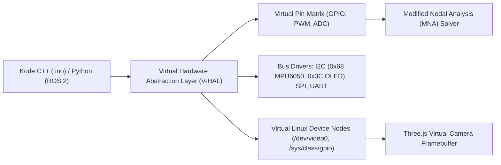

# Spesifikasi Teknis: Elektronika Lanjut, Driver Aktuator & Emulasi Embedded
## Model Elektromekanik, Sirkuit Daya, dan Virtual Hardware Abstraction Layer (V-HAL)

- **Kode Proyek**: `TridiArduSim-PhysicalAI`
- **Versi Dokumen**: 1.0.0
- **Status**: Disetujui untuk Implementasi Solver
- **Terkait dengan**: [02-ARCHITECTURE-SYSTEM-DESIGN.md](file:///Users/user/Projects/simulate/docs/02-ARCHITECTURE-SYSTEM-DESIGN.md), [03-SPECS-ROBOTICS-KINEMATICS.md](file:///Users/user/Projects/simulate/docs/03-SPECS-ROBOTICS-KINEMATICS.md)

---

## 1. Model Elektromekanik Aktuator

Untuk menjembatani sirkuit elektronik dengan dunia fisika 3D, setiap aktuator dimodelkan menggunakan persamaan diferensial dinamika nyata yang menghubungkan tegangan listrik ($V$), arus ($I$), kecepatan sudut ($\omega$), dan torsi mekanik ($\tau$).

### 1.1 Motor DC dengan Gearbox Reduksi
Model sirkuit motor DC terdiri dari resistansi kumparan jangkar $R$, induktansi kumparan $L$, dan gaya gerak listrik balik (*Back-EMF*) $e(t)$:

```
           R          L
  (+) ───/\/\/\────UUUUUU────( M )──── (-)
                                │
                          Back-EMF: e(t) = Ke · ω
```

**Persamaan Elektrik**:
$$
V(t) = L \frac{di(t)}{dt} + R \cdot i(t) + K_e \cdot \omega(t)
$$

**Persamaan Mekanik**:
$$
J \frac{d\omega(t)}{dt} + b \cdot \omega(t) = K_t \cdot i(t) - \frac{\tau_{load}}{\eta \cdot N}
$$

di mana:
- $K_t$: Konstanta torsi motor ($\text{N}\cdot\text{m}/\text{A}$).
- $K_e$: Konstanta Back-EMF ($\text{V}/(\text{rad}/\text{s})$), pada motor ideal $K_e = K_t$.
- $J$: Momen inersia gabungan rotor dan beban.
- $b$: Koefisien redaman gesekan viskos.
- $N$: Rasio reduksi gir gearbox (misal $1:48$ pada motor kuning robotik TT).
- $\eta$: Efisiensi mekanik gir ($0.65 – 0.85$).

**Karakteristik Arus & Torsi Kritis**:
- **Arus Tanpa Beban (*No-Load Current*)**: $I_0 = \frac{b \cdot \omega_{max}}{K_t}$ (sekitar $50 – 150 \text{ mA}$).
- **Arus Macet (*Stall Current*)**: $I_{stall} = \frac{V_{in}}{R}$ (dapat mencapai $1.5 – 3.0 \text{ A}$).
- **Torsi Macet (*Stall Torque*)**: $\tau_{stall} = K_t \cdot I_{stall} \cdot N \cdot \eta$.

### 1.2 RC Servo Motor (TowerPro SG90 & MG996R)
Servo RC dimodelkan sebagai sistem kendali posisi loop-tertutup terintegrasi yang digerakkan oleh pulsa PWM:
- **Frekuensi PWM**: $50 \text{ Hz}$ (Periode $T = 20 \text{ ms}$).
- **Lebar Pulsa Kendali**:
  - $1.0 \text{ ms} \implies 0^\circ$ (Batas kiri penuh)
  - $1.5 \text{ ms} \implies 90^\circ$ (Posisi tengah netral)
  - $2.0 \text{ ms} \implies 180^\circ$ (Batas kanan penuh)
- **Deadband Internal**: Toleransi galat $\approx 5 \;\mu\text{s}$; jika selisih target $< 5 \;\mu\text{s}$, motor masuk mode diam untuk menghemat daya.
- **Slewing Speed & Profil Kecepatan**:
  - SG90 (Nylon Gear): Kecepatan maksimum $0.10 \text{ s} / 60^\circ$ ($600^\circ/\text{s}$), torsi $1.8 \text{ kg}\cdot\text{cm}$ pada $4.8\text{V}$.
  - MG996R (Metal Gear): Kecepatan maksimum $0.17 \text{ s} / 60^\circ$ ($350^\circ/\text{s}$), torsi $11.0 \text{ kg}\cdot\text{cm}$ pada $6.0\text{V}$.

---

## 2. Model Sirkuit Driver Motor

### 2.1 Driver Dual H-Bridge L298N
Modul L298N menggunakan pasangan transistor bipolar persambungan (BJT) Darlington:
- **Tegangan Jatuh Saturasi ($V_{CE(sat)}$)**:
  Arus motor mengalir melewati dua transistor BJT (sisi atas dan sisi bawah). Total penurunan tegangan:
  $$
  V_{drop} = V_{sat(upper)} + V_{sat(lower)} \approx 1.8\text{V} - 2.2\text{V}
  $$
  *Catatan Pendidikan*: Jika baterai $12\text{V}$ dihubungkan ke L298N, tegangan efektif motor hanya sebesar $\approx 10\text{V}$.
- **Disipasi Termal & Panas**:
  $$
  P_{loss} = V_{drop} \cdot I_{motor}
  $$
  Bila motor menarik arus $1.5\text{A}$, daya hilang menjadi $2\text{V} \times 1.5\text{A} = 3.0\text{ Watt}$. Simulator akan memicu peringatan suhu tinggi jika heatsink virtual tidak memadai.
- **Dioda Flyback (Freewheeling Protection)**:
  Menyerap lonjakan tegangan induktif saat PWM berpindah level:
  $$
  V_{kickback} = -L \frac{di}{dt}
  $$

### 2.2 Stepper Driver A4988 / DRV8825
- **Tabel Konfigurasi Microstepping**:

| MS1 | MS2 | MS3 | Resolusi A4988 | Resolusi DRV8825 |
|---|---|---|---|---|
| Low | Low | Low | Full Step (1/1) | Full Step (1/1) |
| High | Low | Low | Half Step (1/2) | Half Step (1/2) |
| Low | High | Low | Quarter Step (1/4) | 1/4 Step |
| High | High | Low | Eighth Step (1/8) | 1/8 Step |
| High | High | High | Sixteenth Step (1/16)| 1/16 Step |
| - | - | - | Tidak didukung | 1/32 Step |

- **Kalkulasi Pembatas Arus (*Current Chopping*) $V_{ref}$**:
  $$
  I_{limit} = \frac{V_{ref}}{8 \times R_s} \quad (\text{pada A4988, dengan } R_s = 0.05\,\Omega \text{ atau } 0.1\,\Omega)
  $$
  Trimmer potensiometer pada model 3D A4988 dapat diputar oleh pengguna untuk mengatur arus motor secara interaktif.

---

## 3. Manajemen Catu Daya & Simulasi Baterai (Power Delivery Network)

Masalah paling umum pada robot pemula adalah **Mikrokontroler mendadak Restart / Reset** saat motor mulai bergerak. Simulator ini secara akurat memodelkan dinamika baterai dan fenomena *Voltage Sag*.

### 3.1 Model Internal Baterai Li-ion / LiPo
Baterai dimodelkan sebagai sumber tegangan kimia ideal dengan resistansi internal seri ($R_{esr}$):

$$
V_{terminal} = V_{OCV}(SoC) - I_{total} \cdot R_{esr}
$$

| Jenis Baterai | Tegangan Nominal | $R_{esr}$ Khas | Kapasitas Khas |
|---|---|---|---|
| 18650 Li-ion (Single Cell) | $3.7\text{V}$ (Penuh $4.2\text{V}$) | $0.05 - 0.12\,\Omega$ | $2200 - 3000\text{ mAh}$ |
| 2S LiPo Pack | $7.4\text{V}$ (Penuh $8.4\text{V}$) | $0.02 - 0.04\,\Omega$ | $1500 - 2200\text{ mAh}$ |
| Baterai Kotak 9V (Alkaline) | $9.0\text{V}$ | $1.5 - 2.5\,\Omega$ (Sangat Tinggi!) | $400 - 550\text{ mAh}$ |

> **Peringatan Simulasi untuk Edukasi**:
> Jika pengguna mencoba menyalakan 2 servo SG90 menggunakan baterai kotak 9V, simulator akan menghitung penurunan tegangan dramatis ($I = 1\text{A} \implies \Delta V = 1\text{A} \times 2\,\Omega = 2\text{V}$ drop), memicu pesan:
> *"Baterai 9V tidak cocok untuk motor karena resistansi internal tinggi! Gunakan baterai Li-ion 18650 atau catu daya eksternal."*

### 3.2 Deteksi Brownout Reset (BOR)
Mikrokontroler virtual memonitor tegangan pin $5\text{V}$ dan $3.3\text{V}$:
- Jika tegangan pada rel $5\text{V}$ turun di bawah **$4.1\text{V}$** selama $> 10 \;\mu\text{s}$, sirkuit proteksi internal AVR/ESP32 virtual akan memicu kondisi **Brownout Reset**, mereset counter memori mikrokontroler dan mencatat galat di Serial Monitor.

---

## 4. Virtual Hardware Abstraction Layer (V-HAL)

V-HAL bertindak sebagai jembatan antara instruksi komputasi virtual dan register I/O sirkuit:



### 4.1 Modul Sensor Bus I2C yang Didukung
- **PCA9685 16-Channel 12-bit PWM I2C Driver**: Mengemulasikan alamat I2C `0x40`, mampu mengontrol hingga 16 servo independen hanya dengan 2 kabel (SDA/SCL).
- **MPU-6050 6-Axis IMU (Akselerometer + Giroskop)**: Mengemulasikan alamat I2C `0x68`, membaca akselerasi gravitasi dan laju sudut dari engine fisika 3D.
- **OLED SSD1306 128x64 I2C Display**: Mengemulasikan alamat `0x3C`, merender buffer grafis mikro langsung ke tekstur kanvas 3D layar OLED.

### 4.2 Virtual V4L2 Camera Device (`/dev/video0`)
Untuk pengujian script Computer Vision (OpenCV / AI):
- Framebuffer kamera virtual di-render oleh Three.js pada resolusi terkalibrasi ($320 \times 240$ atau $640 \times 480$).
- Tersedia pipa data memori bertipe (*Uint8ClampedArray*) yang dapat dibaca oleh fungsi `cv2.VideoCapture(0)` di script Python virtual pengguna.
