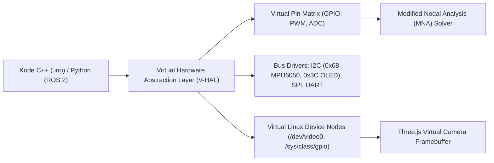

# Spesifikasi Teknis: Elektronika Lanjut, Driver Aktuator & Emulasi Embedded
## Model Elektromekanik, Sirkuit Daya, dan Virtual Hardware Abstraction Layer (V-HAL)

- **Kode Proyek**: `TridiArduSim-PhysicalAI`
- **Versi Dokumen**: 1.1.0 (revisi 4 Oktober 2026 — reframe: model stateful terpisah, bukan MNA dinamis)
- **Status**: Disetujui untuk Implementasi Solver
- **Terkait dengan**: [02-ARCHITECTURE-SYSTEM-DESIGN.md](file:///Users/user/Projects/simulate/docs/02-ARCHITECTURE-SYSTEM-DESIGN.md), [03-SPECS-ROBOTICS-KINEMATICS.md](file:///Users/user/Projects/simulate/docs/03-SPECS-ROBOTICS-KINEMATICS.md)

---

> **Arsitektur eksekusi (v1.1)**: model di dokumen ini **bukan** ekstensi matriks solver sirkuit. Mereka berjalan sebagai **model stateful terpisah** di Circuit Worker, diintegrasikan per timestep sim clock, dan dikopling ke solver DC existing lewat tegangan/arus pada terminal V-HAL (ADD §2.3 & §3). Konsekuensi: back-EMF, inersia, dan thermal terintegrasi numerik **per-aktuator**, bukan per-sirkuit — cukup akurat untuk edukasi, dan jauh lebih murah daripada MNA transien penuh (yang ditunda).

## 1. Model Elektromekanik Aktuator

Untuk menjembatani sirkuit elektronik dengan dunia fisika 3D, setiap aktuator dimodelkan menggunakan persamaan diferensial dinamika nyata yang menghubungkan tegangan listrik ($V$), arus ($I$), kecepatan sudut ($\omega$), dan torsi mekanik ($\tau$).

### 1.1 Motor DC dengan Gearbox Reduksi
Model sirkuit motor DC terdiri dari resistansi kumparan jangkar $R$, induktansi kumparan $L$, dan gaya gerak listrik balik (*Back-EMF*) $e(t)$:

```
           R          L
  (+) ───/\/\/\────UUUUUU────( M )──── (-)
                                │
                          Back-EMF: e(t) = Ke · ω
```

**Persamaan Elektrik**:
$$
V(t) = L \frac{di(t)}{dt} + R \cdot i(t) + K_e \cdot \omega(t)
$$

**Persamaan Mekanik**:
$$
J \frac{d\omega(t)}{dt} + b \cdot \omega(t) = K_t \cdot i(t) - \frac{\tau_{load}}{\eta \cdot N}
$$

di mana:
- $K_t$: Konstanta torsi motor ($\text{N}\cdot\text{m}/\text{A}$).
- $K_e$: Konstanta Back-EMF ($\text{V}/(\text{rad}/\text{s})$), pada motor ideal $K_e = K_t$.
- $J$: Momen inersia gabungan rotor dan beban.
- $b$: Koefisien redaman gesekan viskos.
- $N$: Rasio reduksi gir gearbox (misal $1:48$ pada motor kuning robotik TT).
- $\eta$: Efisiensi mekanik gir ($0.65 – 0.85$).

**Karakteristik Arus & Torsi Kritis**:
- **Arus Tanpa Beban (*No-Load Current*)**: $I_0 = \frac{b \cdot \omega_{max}}{K_t}$ (sekitar $50 – 150 \text{ mA}$).
- **Arus Macet (*Stall Current*)**: $I_{stall} = \frac{V_{in}}{R}$ (dapat mencapai $1.5 – 3.0 \text{ A}$).
- **Torsi Macet (*Stall Torque*)**: $\tau_{stall} = K_t \cdot I_{stall} \cdot N \cdot \eta$.

**Status implementasi (5 Oktober 2026):** Motor DC Gearbox TT memakai preset edukasi $R=6\,\Omega$, $L=2\,mH$, $K_t=0.006\,N\cdot m/A$, $K_e=0.006\,V/(rad/s)$, $J=10^{-5}\,kg\,m^2$, rasio 1:48 dan efisiensi 0.72. Cabang solver memakai ekuivalen $R+L/\Delta t$ serta back-EMF/arus state sebelumnya; dinamika mekanis diperbarui pada fixed-step 5 ms. Nilai ini belum di-fit terhadap data satu motor tertentu.

### 1.2 RC Servo Motor (TowerPro SG90 & MG996R)
Servo RC dimodelkan sebagai sistem kendali posisi loop-tertutup terintegrasi yang digerakkan oleh pulsa PWM:
- **Frekuensi PWM**: $50 \text{ Hz}$ (Periode $T = 20 \text{ ms}$).
- **Lebar Pulsa Kendali**:
  - $1.0 \text{ ms} \implies 0^\circ$ (Batas kiri penuh)
  - $1.5 \text{ ms} \implies 90^\circ$ (Posisi tengah netral)
  - $2.0 \text{ ms} \implies 180^\circ$ (Batas kanan penuh)
- **Deadband Internal**: Toleransi galat $\approx 5 \;\mu\text{s}$; jika selisih target $< 5 \;\mu\text{s}$, motor masuk mode diam untuk menghemat daya.
- **Slewing Speed & Profil Kecepatan**:
  - SG90 (Nylon Gear): Kecepatan maksimum $0.10 \text{ s} / 60^\circ$ ($600^\circ/\text{s}$), torsi $1.8 \text{ kg}\cdot\text{cm}$ pada $4.8\text{V}$.
  - MG996R (Metal Gear): Kecepatan maksimum $0.17 \text{ s} / 60^\circ$ ($350^\circ/\text{s}$), torsi $11.0 \text{ kg}\cdot\text{cm}$ pada $6.0\text{V}$.

---

## 2. Model Sirkuit Driver Motor

### 2.1 Driver Dual H-Bridge L298N
Modul L298N menggunakan pasangan transistor bipolar persambungan (BJT) Darlington:
- **Tegangan Jatuh Saturasi ($V_{CE(sat)}$)**:
  Arus motor mengalir melewati dua transistor BJT (sisi atas dan sisi bawah). Total penurunan tegangan:
  $$
  V_{drop} = V_{sat(upper)} + V_{sat(lower)} \approx 1.8\text{V} - 2.2\text{V}
  $$
  *Catatan Pendidikan*: Jika baterai $12\text{V}$ dihubungkan ke L298N, tegangan efektif motor hanya sebesar $\approx 10\text{V}$.
- **Disipasi Termal & Panas**:
  $$
  P_{loss} = V_{drop} \cdot I_{motor}
  $$
  Bila motor menarik arus $1.5\text{A}$, daya hilang menjadi $2\text{V} \times 1.5\text{A} = 3.0\text{ Watt}$. Simulator akan memicu peringatan suhu tinggi jika heatsink virtual tidak memadai.
- **Dioda Flyback (Freewheeling Protection)**:
  Menyerap lonjakan tegangan induktif saat PWM berpindah level:
  $$
  V_{kickback} = -L \frac{di}{dt}
  $$

**Status implementasi (5 Oktober 2026):** `l298n_dual_hbridge` menyediakan kanal A/B, input EN/PWM dan arah, terminal OUT, VS/VSS/GND. Model menerapkan drop nominal total 2 V, menampilkan estimasi arus/rugi daya, membebankan arus armature terukur-terakhir ke node VS, dan memberi warning di atas 2 A atau saat memakai alkaline 9V pada arus tinggi. Kopling arus dan sag diperbarui per fixed-step; keluaran H-bridge memakai estimasi tegangan sag dari arus langkah sebelumnya. Heatsink virtual memakai jaringan termal orde satu ($R_\theta=25\ ^\circ C/W$, $C_\theta=8\ J/ ^\circ C$), warning pada 90 °C, shutdown pada 150 °C, dan recovery pada 135 °C. Empat diode clamp per dual H-bridge (VF 0.7 V) menyediakan jalur flyback/freewheel dan membatasi OUT pada rel GND/VS; solver memakai konduksi diode piecewise kuasistatik. Switching PWM, current limit aktif, reverse current/charge pack dan validasi terhadap hardware belum dimodelkan.

### 2.2 Stepper Driver A4988 / DRV8825
- **Tabel Konfigurasi Microstepping**:

| MS1 | MS2 | MS3 | Resolusi A4988 | Resolusi DRV8825 |
|---|---|---|---|---|
| Low | Low | Low | Full Step (1/1) | Full Step (1/1) |
| High | Low | Low | Half Step (1/2) | Half Step (1/2) |
| Low | High | Low | Quarter Step (1/4) | 1/4 Step |
| High | High | Low | Eighth Step (1/8) | 1/8 Step |
| High | High | High | Sixteenth Step (1/16)| 1/16 Step |
| - | - | - | Tidak didukung | 1/32 Step |

- **Kalkulasi Pembatas Arus (*Current Chopping*) $V_{ref}$**:
  $$
  I_{limit} = \frac{V_{ref}}{8 \times R_s} \quad (\text{pada A4988, dengan } R_s = 0.05\,\Omega \text{ atau } 0.1\,\Omega)
  $$
  Trimmer potensiometer pada model 3D A4988 dapat diputar oleh pengguna untuk mengatur arus motor secara interaktif.

**Status implementasi saat ini (5 Oktober 2026)**: komponen A4988 menyediakan input listrik STEP/DIR/ENABLE/MS1–MS3/RESET/SLEEP, pemetaan microstep sampai 1/16, hitung falling-edge STEP dengan waktu HIGH minimal 1 µs, batas arus VREF/Rs dan keluaran fase kuasistatik ke NEMA17. Model kuasistatik memperkirakan rugi konduksi dari RDS(on) maksimum 0.86 Ω per lintasan fase, mengintegrasikan junction temperature memakai RθJA 32 °C/W dari datasheet Allegro (kondisi PCB empat lapis) serta Cθ 0.5 J/°C sebagai asumsi edukasi, dan mematikan keluaran pada 165 °C dengan recovery di bawah 150 °C. VDD memakai UVLO 2.8 V dengan hysteresis 90 mV; setelan arus >2.1 A memicu fault OCP terkunci yang dapat dibersihkan setelah setelan diturunkan dan pin SLEEP disikluskan, atau dengan memutus VDD. Status suhu, daya dan arus fase tampil di panel. Angka proteksi dan RθJA merujuk [datasheet resmi Allegro A4988](https://www.allegromicro.com/-/media/files/datasheets/a4988-datasheet.pdf). Ini tetap bukan simulasi chopper PWM cycle-accurate, winding R-L, short-circuit aktual pada terminal, limit arus catu, regenerasi, DRV8825 atau dinamika aktuator-joint. Trimmer mengubah VREF dan Rs secara numerik; validasi arus/termal terhadap modul fisik belum tersedia.

---

## 3. Manajemen Catu Daya & Simulasi Baterai (Power Delivery Network)

Masalah paling umum pada robot pemula adalah **Mikrokontroler mendadak Restart / Reset** saat motor mulai bergerak. Simulator menyediakan model baterai ringkas dan deteksi BOR pada rail yang diberi daya dari pack.

### 3.1 Model Internal Baterai Li-ion / LiPo
Baterai dimodelkan sebagai sumber tegangan kimia ideal dengan resistansi internal seri ($R_{esr}$):

$$
V_{terminal} = V_{OCV}(SoC) - I_{total} \cdot R_{esr}
$$

| Jenis Baterai | Tegangan Nominal | $R_{esr}$ Khas | Kapasitas Khas |
|---|---|---|---|
| 18650 Li-ion (Single Cell) | $3.7\text{V}$ (Penuh $4.2\text{V}$) | $0.05 - 0.12\,\Omega$ | $2200 - 3000\text{ mAh}$ |
| 2S LiPo Pack | $7.4\text{V}$ (Penuh $8.4\text{V}$) | $0.02 - 0.04\,\Omega$ | $1500 - 2200\text{ mAh}$ |
| Baterai Kotak 9V (Alkaline) | $9.0\text{V}$ | $1.5 - 2.5\,\Omega$ (Sangat Tinggi!) | $400 - 550\text{ mAh}$ |

> **Peringatan Simulasi untuk Edukasi**:
> Jika pengguna mencoba menyalakan 2 servo SG90 menggunakan baterai kotak 9V, simulator akan menghitung penurunan tegangan dramatis ($I = 1\text{A} \implies \Delta V = 1\text{A} \times 2\,\Omega = 2\text{V}$ drop), memicu pesan:
> *"Baterai 9V tidak cocok untuk motor karena resistansi internal tinggi! Gunakan baterai Li-ion 18650 atau catu daya eksternal."*

### 3.2 Deteksi Brownout Reset (BOR)
Mikrokontroler virtual memonitor tegangan pin $5\text{V}$ dan $3.3\text{V}$:
- Jika tegangan pada rel $5\text{V}$ turun di bawah **$4.1\text{V}$** selama $> 10 \;\mu\text{s}$, sirkuit proteksi internal AVR/ESP32 virtual akan memicu kondisi **Brownout Reset**, mereset counter memori mikrokontroler dan mencatat galat di Serial Monitor.

**Status implementasi (5 Oktober 2026):** komponen katalog `battery_pack` menyediakan preset Li-ion 18650 1S, LiPo 2S, dan alkaline 9V, kurva OCV berbasis SoC dengan interpolasi, ESR/kapasitas/batas discharge yang dapat diubah, switch, arus terminal, daya, serta integrasi SoC charge/discharge di fixed-step. Proteksi arus melepas sumber saat arus discharge melampaui batas dan meminta reset manual. Load resistor/periferal listrik, SG90 (arus transient 0.65 A selama 300 ms lalu 0.08 A saat commanded), A4988 (estimasi daya fase ke VMOT), dan L298N (armature current ke VS) membebani node pack sehingga ESR menghasilkan sag. Alkaline 9V memberi warning di atas 0.5 A.

Detektor BOR memonitor rail 5V Uno pada 4.1V dan rail 3V3 ESP32 pada 3.0V. Ketika rail melewati threshold lebih lama dari 10 µs, worker mengosongkan output GPIO/interrupt dan menahan loop sketch; setelah rail pulih dengan hysteresis 0.1V, sketch dibuat ulang dan `setup()` dijalankan. Karena worker listrik melangkah 5 ms, respons reset terukur pada resolusi fixed-step (maksimal sekitar 5 ms setelah pengamatan rail), bukan timer analog 10 µs.

Komponen `dc_dc_converter` buck-boost menyediakan rail 3.3/5/9/12 V dari VIN 2.5–24 V, batas keluaran 0.25–3 A (default 2 A), efisiensi default 90%, dan telemetry input/output. Limit arus memakai active-set CV/CC dalam MNA sehingga tegangan rail turun saat beban melebihi batas. Komponen `battery_charger` menerima input dari catu DC dan menyuntik arus charge terkontrol ke terminal battery pack: CC sampai mendekati tegangan akhir, lalu CV/taper pada 4.2 V (Li-ion 1S) atau 8.4 V (LiPo 2S). SoC diintegrasikan memakai arus bersih pack, sehingga beban paralel mengurangi net charge. LiPo 2S menyimpan SoC dan OCV tiap sel; passive balancing edukasional mengalirkan 50 mA dari sel yang lebih tinggi ketika beda OCV mencapai 30 mV, sementara batas arus charge mengikuti headroom sel tertinggi. Alkaline tidak didukung charger. Charger memperkirakan rugi konversi dari efisiensi dan arus keluar, meneruskannya ke jaringan termal RC edukasi, mematikan charge pada 90 °C, dan memulihkan di bawah 75 °C; polaritas input negatif atau koneksi BAT silang memblokir arus. Tail-current termination menghentikan charge pada 0.05C saat CV dan mengizinkan recharge kembali saat SoC di bawah 98%. Safety timer edukasional menghitung waktu charge aktif simulasi (default 10 jam, dapat diatur 1–24 jam), lalu menghentikan charge sampai pengguna melakukan reset manual. Timeout backup ini mengikuti jenis proteksi yang ada pada IC charger seperti [TI BQ2405x](https://www.ti.com/product/BQ24052); nilainya tidak universal dan bukan pengganti proteksi hardware. Proteksi polaritas masih ideal dan tidak menghitung diode/reverse current. Charger/buck-boost bersifat kuasistatik tanpa ripple/start-up; proteksi overvoltage individual dan profil kimia sel spesifik belum tersedia. Ambang timer, balancing, dan termal adalah asumsi edukasi, belum divalidasi terhadap hardware. Battery pack tidak memodelkan aging. `dc_supply` tetap sumber ideal 0–24 V tanpa resistansi seri atau limit arus; battery current A4988 dan L298N adalah estimasi daya kuasistatik, bukan transistor/chopper switching.

---

## 4. Virtual Hardware Abstraction Layer (V-HAL)

V-HAL bertindak sebagai jembatan antara instruksi komputasi virtual dan register I/O sirkuit:



### 4.1 Modul Sensor Bus I2C yang Didukung

> **Status implementasi (5 Oktober 2026):** V-HAL `Wire` memiliki buffer transaksi TX/RX 32-byte, ACK/NACK, `beginTransmission`, `write`, `endTransmission`, `requestFrom`, `available`, dan `read`. Worker memberi ACK hanya jika alamat perangkat cocok, jalur SDA/SCL terhubung ke bus MCU (Uno SDA/SCL atau ESP32 GPIO21/GPIO22), dan perangkat terdaya. LCD `0x27` dan OLED `0x3C` memakai pemeriksaan bus/power. Shim Adafruit mengirim urutan init, address-window, dan framebuffer OLED lewat transaksi I2C dengan control byte serta chunk maksimal 32 byte. Framebuffer SSD1306 128×64 monochrome memakai buffer 1-bit, dikonversi ke layout page/column GDDRAM, dan dirender sebagai tekstur kanvas emissive. Operasi GFX yang dimodelkan mencakup teks font 5×7 ASCII dasar, pixel, line, rectangle, circle, triangle, bitmap, clear dan invert. Sketch yang memakai `Wire` langsung dapat mengirim control byte command/data, mengatur rentang kolom/halaman dan mode alamat, menulis data GDDRAM, serta memakai perintah display on/off dan inverse. Parser menangani urutan argumen command lintas transaksi; perintah SSD1306 lain yang tidak disebutkan belum dimodelkan. IMU berpin I2C pada `0x68`, mendukung pembacaan register identitas serta snapshot accel/gyro yang diskalakan ke format MPU-6050. PCA9685 `0x40` memiliki komponen berpin `PWM0–PWM15`, register frekuensi/pulse untuk `Adafruit_PWMServoDriver`, dan kopling keluaran ke servo yang tersambung; OE aktif-low harus di-enable dengan ditarik LOW. Preset I2C scanner memindai alamat 7-bit 0x01–0x7E dengan `Wire.beginTransmission`/`endTransmission` dan memeriksa ACK. Tes runtime mock menemukan alamat yang tersambung dan bertenaga pada OLED `0x3C`, LCD `0x27`, PCA9685 `0x40`, dan IMU `0x68`; alur worker/browser untuk scanner masih belum diuji. Duty dan pulsa menjadi state V-HAL, bukan bentuk gelombang PWM 12-bit yang dimasukkan ke MNA. Multi-master dan arbitrase bus belum dimodelkan.
- **PCA9685 16-Channel 12-bit PWM I2C Driver**: Mengemulasikan alamat I2C `0x40`, mampu mengontrol hingga 16 servo independen hanya dengan 2 kabel (SDA/SCL).
- **MPU-6050 6-Axis IMU (Akselerometer + Giroskop)**: Mengemulasikan alamat I2C `0x68`, membaca akselerasi gravitasi dan laju sudut dari engine fisika 3D.
- **OLED SSD1306 128x64 I2C Display**: Mengemulasikan alamat `0x3C`, merender buffer grafis mikro langsung ke tekstur kanvas 3D layar OLED.

### 4.2 Kamera RGB-D dan Status V4L2 (`/dev/video0`)
Komponen `rgbd_camera` merender scene Three.js pada 320×240 atau 640×480 dengan FOV terkonfigurasi. Panel/store menyimpan RGBA (`Uint8Array`), `Float32Array` jarak dalam meter, waktu simulasi, serta intrinsics $f_x, f_y, c_x, c_y$. Depth dikodekan 24-bit pada pass GPU dan diekspansi di CPU. Capture berjalan maksimal 10 Hz sim-time dengan readback sinkron; setiap capture memiliki sequence monotonik dan snapshot ditransfer ke simulation worker ketika signature frame berubah, termasuk bila perubahan pose menghasilkan frame baru pada timestamp sim-time sama. Shim sketch `cameraDepth(id,x,y)`, `cameraRgb(id,x,y,channel)`, `cameraWidth(id)`, dan `cameraHeight(id)` membaca frame terakhir. V-SBC meneruskan frame RGBA terbaru ke worker Python; `cv2.VideoCapture(0)` memflip origin baris menjadi top-left dan mengonversi RGB ke BGR. Worker menerima update kamera maksimal setiap 50 ms jika `sampleCount` berubah. Ini bukan perangkat `/dev/video0`/V4L2 dan transfer masih menyalin buffer. Paket Pyodide NumPy/OpenCV dimuat dari CDN pada first run; uji browser untuk jalur tersebut masih terbuka.

LiDAR planar tersedia sebagai komponen scene: satu scan 360° berisi 360 atau 720 sampel jarak (meter), hit mask, dan maksimum 4–30 m; sampling maksimal 10 Hz sim-time. Scan terbaru dikirim ke simulation worker dan tersedia pada sketch melalui `lidarRange(id,index)` serta `lidarHit(id,index)`. Raycast memakai Three.js biasa, belum memakai BVH dan belum menyediakan intensitas pantulan.

Komponen IMU 6-axis menghasilkan akselerasi spesifik dalam m/s² (termasuk gravitasi) dan laju sudut dalam rad/s. Pose sumber dapat memakai komponen sensor sendiri atau robot EduArm/AeroArm/RoverBot; translasi dan rotasi diturunkan dari perubahan pose pada simulation time. Gaussian noise memakai seed per sensor yang deterministik, tanpa bias drift. Snapshot enam sumbu terbaru dikirim ke simulation worker dan dapat dibaca sketch dengan `imuRead(id,"ax")` sampai `imuRead(id,"gz")`; melalui bus `0x68`, register output accel/gyro menyediakan snapshot yang sama dalam format signed 16-bit MPU-6050. Pembaruan dibatasi oleh frekuensi state UI (maksimum praktis sekitar 60 Hz saat ini); sensor belum terhubung ke Python/AI worker atau rigid-body engine. Nilai akselerasi lengan mengikuti FK model kinematik.
