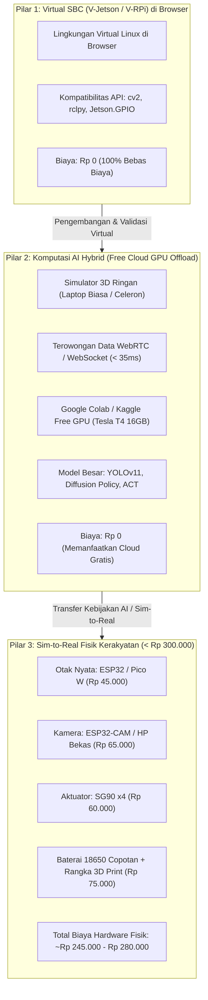

# Framework Physical AI Kerakyatan
## Menembus Batasan Biaya Hardware (NVIDIA Jetson & Raspberry Pi) di Indonesia

- **Kode Proyek**: `TridiArduSim-PhysicalAI`
- **Versi Dokumen**: 1.0.0
- **Status**: Disetujui untuk Pedoman Demokratisasi Hardware
- **Terkait dengan**: [01-PRD-PHYSICAL-AI-ROBOTICS.md](file:///Users/user/Projects/simulate/docs/01-PRD-PHYSICAL-AI-ROBOTICS.md), [04-SPECS-ADVANCED-ELECTRONICS-EMULATION.md](file:///Users/user/Projects/simulate/docs/04-SPECS-ADVANCED-ELECTRONICS-EMULATION.md)

---

## 1. Analisis Krisis Aksesibilitas Hardware di Indonesia

Dalam ekosistem robotika modern global, standar de facto pengembangan **Physical AI / Embodied AI** bertumpu pada perangkat keras bernilai tinggi:
- **NVIDIA Jetson Orin Nano Dev Kit (8GB)**: Rp 8.500.000 – Rp 13.500.000
- **Raspberry Pi 5 (8GB) + Active Cooler + Power Supply**: Rp 1.800.000 – Rp 2.400.000
- **Kamera Depth Intel RealSense D435i**: Rp 7.500.000 – Rp 9.800.000
- **RPLiDAR A1M8 360° Laser Scanner**: Rp 1.850.000 – Rp 2.400.000
- **Total Setup Riset Standar Laboratorium**: **Rp 19.650.000 – Rp 28.100.000**

### Realitas Ekonomi Insinyur & Pelajar Perintis Indonesia
- Upah Minimum Regional (UMR) di berbagai daerah berkisar antara **Rp 2.200.000 hingga Rp 5.000.000**.
- Uang Kuliah Tunggal (UKT) mahasiswa teknik rata-rata berkisar **Rp 3.000.000 – Rp 6.000.000 per semester**.
- Membeli satu unit Jetson Orin Nano setara dengan 2–3 bulan upah penuh atau biaya hidup kuliah satu semester. Ketiadaan akses ini menciptakan kesenjangan pengetahuan yang sangat lebar (*technological gap*), di mana generasi muda Indonesia hanya menjadi konsumen teknologi luar tanpa mampu mempelajari arsitektur dalamnya.

Platform ini dibangun dengan satu keyakinan filosofis: **Kecerdasan Buatan Fisik tidak boleh menjadi hak eksklusif mereka yang mampu membeli hardware mahal.**

---

## 2. Tiga Pilar Solusi Terobosan (The 3 Breakthrough Pillars)



---

## 3. Pilar 1: Virtual SBC (V-Jetson / V-RPi) di Browser

Daripada memaksa pengguna menginstal OS Linux di partisi komputer atau membeli papan fisik, simulator menyediakan **lapisan abstraksi V-SBC (Virtual Single Board Computer)**.

### 3.1 Kompatibilitas API Python Standar
Pengguna menulis kode dalam editor Monaco browser dengan sintaksis Python persis seperti yang berjalan di Jetson Nano:

```python
# Script yang ditulis pengguna di TridiArduSim (Sama persis dengan Jetson asli!)
import cv2
import numpy as np
import Jetson.GPIO as GPIO

# Inisialisasi Pin V-HAL
SERVO_PIN = 18
GPIO.setmode(GPIO.BCM)
GPIO.setup(SERVO_PIN, GPIO.OUT)
pwm = GPIO.PWM(SERVO_PIN, 50)  # 50 Hz PWM
pwm.start(7.5)                 # Posisi 90 derajat

# Baca aliran kamera virtual dari engine 3D Three.js
cap = cv2.VideoCapture(0)

while True:
    ret, frame = cap.read()
    if not ret:
        break
    
    # Deteksi objek sederhana (contoh: tracking bola merah)
    hsv = cv2.cvtColor(frame, cv2.COLOR_BGR2HSV)
    lower_red = np.array([0, 120, 70])
    upper_red = np.array([10, 255, 255])
    mask = cv2.inRange(hsv, lower_red, upper_red)
    
    contours, _ = cv2.findContours(mask, cv2.RETR_TREE, cv2.CHAIN_APPROX_SIMPLE)
    if contours:
        c = max(contours, key=cv2.contourArea)
        (x, y), radius = cv2.minEnclosingCircle(c)
        # Kendalikan sudut servo berdasarkan koordinat bola
        target_angle = np.interp(x, [0, 640], [0, 180])
        duty = 2.5 + (target_angle / 18.0)
        pwm.ChangeDutyCycle(duty)
```

**Bagaimana ini bekerja di browser?**
- `cv2`: Menggunakan modul WebAssembly OpenCV (`opencv.js`).
- `cv2.VideoCapture(0)`: Mengambil frame buffer langsung dari `THREE.WebGLRenderTarget` kamera simulator.
- `Jetson.GPIO`: Menulis sinyal ke register pin V-HAL di Worker Sirkuit, yang kemudian menggerakkan geometri servo 3D di viewport secara sinkron!

---

## 4. Pilar 2: Komputasi AI Hybrid (Free Cloud GPU Offloading)

Model Physical AI generasi terkini (misal: **Action Chunking with Transformers (ACT)**, **Diffusion Policy**, atau **YOLOv11 Object Detection**) memerlukan komputasi GPU bertenaga. Pengguna ber-laptop kentang (Intel Celeron, Core i3 lawas) dapat memanfaatkan arsitektur hybrid:

### 4.1 Arsitektur Loop Tertutup Browser-Cloud
1. **Viewport 3D Lokal**: Berjalan ringan di browser pengguna pada 60 FPS.
2. **Streaming Frame Kamera**: Canvas kamera virtual dikompresi menjadi format JPEG/WebP ringan (resolusi $320 \times 240$) dan dialirkan melalui WebSocket atau WebRTC DataChannel.
3. **Penyedia Komputasi**: Notebook **Google Colab (Gratis GPU NVIDIA Tesla T4 VRAM 16GB)** atau **Kaggle Notebook**.
4. **Eksekusi AI di Colab**:
   - Menerima gambar dari browser.
   - Menjalankan model AI canggih (PyTorch, TensorRT, HuggingFace transformers).
   - Menghasilkan vektor aksi kendali end-effector atau kecepatan motor ($v_x, \omega$).
5. **Eksekusi Fisika**: Browser menerima aksi kendali dengan latensi round-trip $< 35\text{ ms}$, lalu mengerakkan sendi robot di kanvas 3D.

### 4.2 Template 1-Klik Google Colab
Platform menyediakan tombol *"Buka di Google Colab"*. Pengguna cukup menekan tombol tersebut, menjalankan satu sel Python di Colab yang menginisialisasi tunnel aman, dan memasukkan URL tunnel ke simulator. **Tanpa biaya sepeser pun!**

---

## 5. Pilar 3: Sim-to-Real Kerakyatan (< Rp 300.000)

Ketika model dan perancangan di simulator sudah terbukti bekerja secara virtual, insinyur perintis dapat mewujudkannya menjadi robot fisik nyata dengan biaya yang sangat terjangkau.

### 5.1 Bill of Materials (BOM) Super Hemat (Harga Pasar Indonesia 2026)

| Komponen | Spesifikasi / Alternatif Murah | Estimasi Harga (Tokopedia / Shopee) |
|---|---|---|
| **Otak Pengendali (MCU)** | ESP32-WROOM-32 30-Pin Type-C | Rp 45.000 – Rp 52.000 |
| **Kamera Vision AI** | Modul ESP32-CAM OV2640 **atau** Kamera HP bekas via WiFi | Rp 65.000 – Rp 72.000 (atau Rp 0 jika pakai HP) |
| **Aktuator Sendi** | 4x Micro Servo TowerPro SG90 (Nylon) | Rp 15.000 x 4 = Rp 60.000 |
| **Regulator Tegangan** | Modul DC-DC Buck Converter LM2596 (3A) | Rp 12.000 |
| **Catu Daya Baterai** | 2x Baterai Li-ion 18650 (Copotan Laptop Bekas Berkualitas) | Rp 10.000 x 2 = Rp 20.000 |
| **Holder Baterai** | Holder 2x 18650 Seri dengan Sakelar On/Off | Rp 8.000 |
| **Modul Charger Baterai**| TP4056 dengan Proteksi Baterai Type-C | Rp 4.500 |
| **Bahan Rangka Mekanik** | Cetak 3D di Makerspace Kampus / Jasa Lokal (atau Kardus Laser) | Rp 30.000 – Rp 40.000 |
| **Kabel & Konektor** | Jumper Dupont 40 pin + Sakelar Mini | Rp 8.000 |
| **TOTAL BIAYA HARDWARE FISIK** | **Lengkap dengan Vision & 4-DOF Robot!** | **Rp 252.500 – Rp 274.500** |

### 5.2 Strategi Ekspor Kode Zero-Rewrite (Sim-to-Real Bridge)
- **WebSerial Flasher Terintegrasi**: Pengguna mencolokkan kabel USB ESP32 ke laptop. Dari simulator di browser, pengguna menekan tombol *"Flash ke ESP32 Fisik"*.
- **Firmware Universal Micro-Bridge**: ESP32 secara otomatis dipasangi firmware komunikasi ringan yang menerima perintah target sudut sendi via USB Serial atau WebSocket WiFi.
- Kode kontrol kinematika dan algoritma AI yang sudah diuji di simulator langsung mengendalikan robot nyata di atas meja kerja, **tanpa perlu menulis ulang kode dari nol!**
