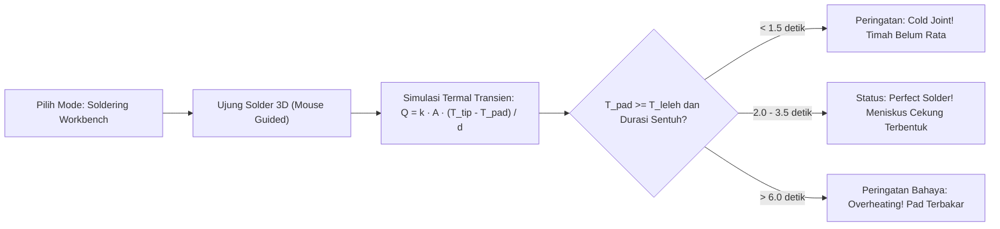

# Panduan Standar Soldering, Assembly Mekanik Robotika & Output 3D Fungsional
## Pedoman Perakitan Perangkat Keras Nyata dan Spesifikasi Fitur Virtual Soldering

- **Kode Proyek**: `TridiArduSim-PhysicalAI`
- **Versi Dokumen**: 1.1.0 (revisi 4 Oktober 2026 — label model pedagogis & penundaan Gerber/STEP)
- **Status**: Disetujui untuk Standar Perakitan & Fitur Simulator
- **Terkait dengan**: [01-PRD-PHYSICAL-AI-ROBOTICS.md](file:///Users/user/Projects/simulate/docs/01-PRD-PHYSICAL-AI-ROBOTICS.md), [05-DEMOCRATIZED-PHYSICAL-AI-FRAMEWORK.md](file:///Users/user/Projects/simulate/docs/05-DEMOCRATIZED-PHYSICAL-AI-FRAMEWORK.md)

---

## 1. Standar Soldering Profesional untuk Robotika & Elektronika Daya

Dalam robotika bergerak, sambungan elektronik mengalami tekanan dinamis yang jauh lebih berat dibanding perangkat elektronik statis: getaran konstan roda/motor, hentakan torsi mendadak, perubahan suhu driver daya, dan tegangan tarik pada kabel sendi. Sambungan solder yang buruk adalah **penyebab nomor satu kegagalan robot di lapangan**.

```
           [BENTUK SAMBUNGAN SOLDER IDEAL]
                   Kaki Komponen
                        │ │
                        │ │
             Meniskus  ╱   ╲  Meniskus Cekung (Concave Fillet)
             Cekung   ╱     ╲ Sudut Pembasahan: θ < 30°
             ────────┴───────┴──────── Pad Tembaga PCB
             ═════════════════════════ Lapisan Substrat FR-4
```

### 1.1 Kriteria Kualitas Solder Standar IPC-A-610 Class 2
- **Meniskus Cekung (*Concave Fillet*)**: Timah harus mengalir membentuk kurva lereng yang halus, bukan menumpuk seperti bola bulat cembung (*too much solder*) atau kurus tipis (*starved joint*).
- **Pembasahan Penuh (*100% Pad Wetting*)**: Logam timah harus melebur dan menyatu sepenuhnya dengan permukaan cincin pad tembaga dan kaki komponen tanpa celah udara.
- **Pengisian Lubang (*Barrel Fill*)**: Pada PCB double-layer Through-Hole, timah harus meresap naik ke dalam lubang plated through-hole (PTH) minimal 75% dari ketebalan papan.
- **Permukaan Logam**:
  - Timah bertimbal (Sn63/Pb37): Mengkilap cerah seperti cermin (*bright and shiny*).
  - Timah bebas timbal (SAC305): Halus merata dengan kilau satin (*satin/semi-matte uniform*).

---

## 2. Parameter Temperatur, Timah & Penggunaan Flux

### 2.1 Pemilihan Paduan Logam Solder (Solder Alloys)

| Jenis Paduan | Komposisi Kimia | Titik Leleh | Karakteristik & Rekomendasi |
|---|---|---|---|
| **Eutectic Leaded (Sn63/Pb37)** | 63% Timah, 37% Timbal | **$183^\circ\text{C}$ (Pasti)** | **Sangat Direkomendasikan untuk Pemula & Edukasi**. Meleleh dan membeku seketika tanpa fase bubur (*plastic phase*), mengurangi risiko cold joint akibat tangan bergetar. |
| **Lead-Free (SAC305)** | 96.5% Sn, 3.0% Ag, 0.5% Cu | **$217^\circ\text{C} - 220^\circ\text{C}$** | Standar ramah lingkungan industri (RoHS). Membutuhkan suhu solder lebih tinggi dan flux aktif. |

### 2.2 Panduan Temperatur Solder Station

```
[Distribusi Temperatur Kerja Rekomendasi]
Through-Hole Standar (Resistor/Pin) : 310°C - 330°C (Sn63) / 340°C - 360°C (SAC305)  [2-3 Detik]
Komponen Sensitif (Sensor/IC/LED)   : 290°C - 310°C (Sn63) / 330°C - 340°C (SAC305)  [< 2 Detik]
Bidang Termal Besar (XT60 / GND Pad): 380°C - 400°C (Mata Chisel Lebar 3.2mm)        [4-5 Detik]
```

### 2.3 Aturan Emas Aplikasi Flux
1. **Flux Bukan Tambahan Opsional, Melainkan Keharusan**: Lapisan tembaga PCB selalu teroksidasi oleh udara. Flux membersihkan lapisan oksida dan menurunkan tegangan permukaan cairan timah seketika.
2. Gunakan **Liquid Rosin Flux Pen** atau pasta flux RMA (*Rosin Mildly Activated*) pada pad sebelum menyentuhkan mata solder.
3. Bersihkan sisa flux setelah selesai menggunakan Isopropil Alkohol (IPA 99%) dan sikat berbulu halus untuk mencegah korosi kimia jangka panjang.

---

## 3. Matriks Identifikasi & Solusi Cacat Solder (Troubleshooting)

| Cacat Solder | Gejala Visual | Penyebab Fisik | Dampak pada Robot | Prosedur Perbaikan |
|---|---|---|---|---|
| **Cold Solder Joint (Sambungan Dingin)** | Permukaan kusam, berkerut, berbutir, retak mikroskopis. | Kaki komponen bergerak saat pendinginan, atau panas diangkat sebelum pad matang. | Resistansi kontak tinggi intermiten; mikrokontroler mendadak hang saat robot berjalan di lantai bergelombang. | Beri setetes flux cair, tempelkan mata solder bersih selama 2 detik sampai timah meleleh ulang mengalir rata. |
| **Solder Bridge (Korsleting Timah)** | Jembatan timah menghubungkan dua pin atau pad bersebelahan. | Pemberian kawat timah berlebih, mata solder terlalu besar, atau kurang flux. | Korsleting catu daya; driver motor atau mikrokontroler terbakar seketika. | Oleskan flux cair melimpah, gunakan pita hisap tembaga (*copper desoldering wick*) untuk menarik kelebihan timah. |
| **Lifted Pad (Pad Tembaga Mengelupas)** | Cincin tembaga lepas dari substrat hijau FR-4. | Pemanasan terlalu panas ($> 400^\circ\text{C}$) atau ditekan terlalu lama ($> 6$ detik). | Jalur listrik terputus permanen. | Kerik lapisan solder mask pada jalur tembaga terdekat, pasang kawat jumper enamel kecil (*bodge wire*) dilem epoxy. |
| **Insufficient Wetting (Timah Menolak Menempel)** | Timah mengumpul membentuk bola di kaki komponen, pad PCB tetap bersih kosong. | Pad tembaga kotor/teroksidasi parah, atau suhu pad belum mencapai titik cair timah. | Tidak ada kontak elektrik. | Kerik pad dengan penghapus pensil/serat kaca, tambahkan flux aktif, pastikan ujung mata solder menyentuh kaki DAN pad secara bersamaan. |

---

## 4. Manajemen Kabel & Konektor Robotika (Wiring Harness)

### 4.1 Pemilihan Ukuran Kabel (American Wire Gauge - AWG)

$$
\Delta V = 2 \cdot L \cdot I \cdot R_{kabel}
$$

| Fungsi Kabel pada Robot | Arus Khas | Rekomendasi AWG | Jenis Insulasi |
|---|---|---|---|
| **Kabel Baterai Utama (LiPo/18650)** | $5.0\text{A} - 15.0\text{A}$ | **AWG 14 – AWG 16** | Silicone High-Strand (Super Lentur) |
| **Daya Motor DC / Stepper NEMA 17** | $1.0\text{A} - 3.0\text{A}$ | **AWG 18 – AWG 20** | Silicone / PVC Fleksibel |
| **Daya Servo Mikro (SG90 / MG996R)**| $0.5\text{A} - 1.5\text{A}$ | **AWG 22 – AWG 24** | PVC Ribbon Wire |
| **Sinyal Logika (PWM, I2C, SPI, UART)**| $< 0.05\text{A}$ | **AWG 26 – AWG 28** | Dupont Header Wire |

### 4.2 Standar Konektor Anti-Lepas
- **Jangan gunakan jumper Dupont longgar untuk sendi robot yang bergerak**: Getaran motor akan membuat pin Dupont bergeser dan lepas.
- Gunakan konektor berkancing pengunci **JST-XH 2.54mm** atau **Molex SL** pada setiap sambungan modular motor dan sensor.
- Gunakan konektor polaritas berkunci **XT30 / XT60** berlapis emas untuk sambungan baterai Li-ion, mencegah kecelakaan polaritas terbalik (*reverse polarity explosion*).

### 4.3 Strain Relief pada Sendi Berputar
- Sediakan lengkungan cadangan (*service loop*) sepanjang $30 – 50\text{ mm}$ di setiap sendi rotasi.
- Balut pertemuan kabel dengan **selongsong bakar (*heat-shrink tubing*)**, lalu kencangkan dengan kabel ties (*cable zip tie*) ke sasis robot berjarak minimal $15\text{ mm}$ dari titik sambungan solder. Beban tekukan harus diterima oleh insulasi silikon kabel, bukan oleh sambungan solder!

---

## 5. Fitur Baru TridiArduSim: Virtual Soldering & Assembly Simulator

Untuk mempersiapkan pengguna sebelum memegang solder panas sungguhan, simulator menyediakan fitur interaktif baru.

> **Sifat model (v1.1)**: persamaan `Q = k·A·(T_tip − T_pad)/d` + ambang durasi (1.5 s / 3.5 s / 6.0 s) adalah **model pedagogis** — heuristik aturan-minta untuk mengajarkan urutan, durasi, dan kesalahan umum; **bukan** solusi PDE difusi panas. Jangan dipasarkan sebagai simulasi termal fisika-akurat atau prediktor suhu absolut.

> **Status kode (5 Oktober 2026):** mode *Virtual Soldering Workbench* tersedia dari menu Tools. Fixture 3D memiliki empat pad dengan pitch 2.54 mm (skala adegan 1 unit ≈ 5 mm); hover memilih target mata solder, tombol tahan memanaskan pad, dan pengguna dapat memberi timah. Alloy Sn63/Pb37 (183 °C) dan SAC305 (219 °C), slider suhu ujung, kapasitas termal pad sinyal/ground-plane, status cold/good/excess-heat/overheated, serta peringatan bridge pad bersebelahan sudah tersedia. Bead dirender sebagai geometri prosedural sederhana, belum vertex-shader deformation; bridge hanya dideteksi dan diberi peringatan di fixture latihan, belum mengubah netlist rangkaian. Unit test memverifikasi kontras pemanasan signal/ground, klasifikasi mutu, dan bridge. Nilai suhu tetap keluaran heuristik edukasi, bukan prediksi fisik.



### 5.1 Fungsionalitas Modul Soldering Virtual
1. **Visualisasi Aliran Timah Dinamis**: Timah mencair secara prosedural di sekitar pin komponen menggunakan *vertex shader deformation* Three.js.
2. **Kalkulator Termal Real-Time**: Menghitung kapasitas panas pad (pad kecil vs ground plane lebar) sehingga pengguna belajar bahwa ground pad membutuhkan pemanasan lebih lama.
3. **Pemeriksa Solder Bridge Otomatis**: Jika pengguna memberikan timah terlalu banyak pada pin mikrokontroler yang berjarak $2.54\text{ mm}$, algoritma simulator mendeteksi tabrakan mesh cairan timah dan memicu pesan hubung singkat.

---

## 6. Pipeline Ekspor Output 3D Fungsional & Fabrikasi

Simulator tidak hanya berhenti pada visualisasi layar, tetapi menyediakan jembatan langsung ke pabrikasi nyata:

### 6.1 Ekspor Model Mekanik 3D (STL / STEP Siap Cetak FDM)
> **Scope v1.1**: **STL feasible** — ekspor mesh three.js dengan kompensasi toleransi di bawah. **STEP ditunda** — three.js tidak menghasilkan geometri parametrik B-Rep; STEP membutuhkan pipeline CAD terpisah, bukan fitur yang bisa ditambahkan ke scene graph existing.
- **Kompensasi Toleransi Cetak 3D**:
  - Diameter lubang sekrup M3 diekspor sebesar **$3.3\text{ mm}$** (kompensasi penyusutan material plastik PLA/PETG sebesar $+0.3\text{ mm}$).
  - Lubang untuk **Heat-Set Brass Threaded Insert M3** diekspor dengan diameter presisi **$4.2\text{ mm}$** dan kedalaman **$5.0\text{ mm}$**.
  - Spline dudukan servo horn dirancang dengan clearance $+0.15\text{ mm}$ agar pas (*press-fit snugly*).
- Pengguna cukup menekan tombol *"Ekspor STL Robot"* untuk mendapatkan file siap potong (*slicing*) di Ultimaker Cura atau PrusaSlicer.

### 6.2 Ekspor Skematik & File Manufaktur PCB (Gerber Package)
> **Status v1.1: DITUNDA.** Konversi breadboard→Gerber membutuhkan **engine layout PCB** (penempatan pad, rute jalur, alokasi layer, DRC) — proyek EDA tersendiri yang tidak dimiliki proyek ini. Yang tersedia di P2: **ekspor netlist + BOM** sebagai input manual ke KiCad, dan/atau template perfboard/PCB tetap per-model-robot. Klaim v1.0 "langsung diunggah ke JLCPCB" ditarik sampai layout engine tersedia.

- *(Konsep awal, sebagai referensi target jangka panjang.)* Konversi rangkaian breadboard virtual menjadi **Gerber Format RS-274X**:
  - Lapisan Tembaga Atas/Bawah (`.GTL`, `.GBL`).
  - Lapisan Solder Mask (`.GTS`, `.GBS`).
  - Lapisan Silk Screen Logo & Label Pin (`.GTO`, `.GBO`).
  - File Bor Lubang CNC Excellon (`.DRL`).
- File Gerber dapat langsung diunggah oleh pengguna ke penyedia jasa cetak PCB lokal atau global (JLCPCB, PCBWay) seharga < Rp 30.000 untuk 5 keping PCB!

### 6.3 Panduan Perakitan Langkah-demi-Langkah 3D (Exploded View Manual)
- Simulator menyertakan slider animasi *Exploded View*: komponen terurai secara visual di ruang 3D, menunjukkan urutan pemasangan baut, mur, ring, penempatan servo, dan rute jalur kabel satu per satu secara intuitif.
