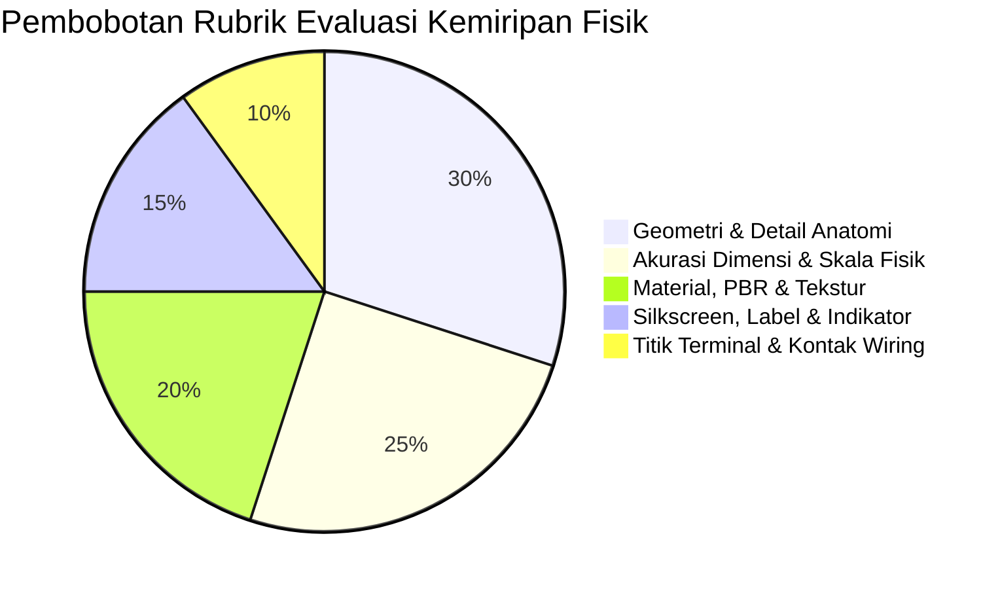
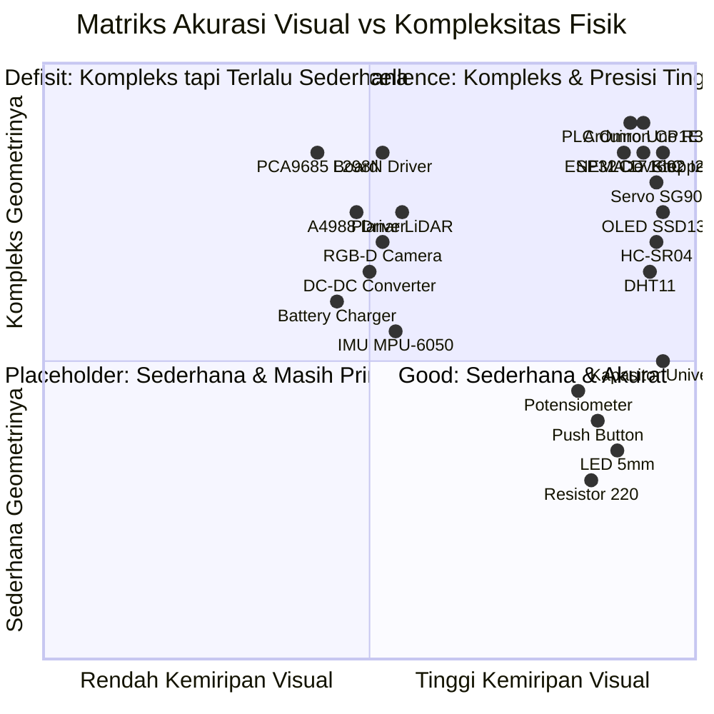

# 07. Evaluasi Mendalam & Audit Skor Kemiripan Desain 3D Komponen Simulasi vs Komponen Nyata

> **Status Audit**: Penilaian ulang kode/geometri selesai · **Tanggal**: 6 Oktober 2026
> **Ruang Lingkup**: Seluruh 31 Entri Model 3D (34 Tipe Katalog di `ComponentRegistry.ts`)  
> **Tujuan**: Menjadi acuan evaluasi jujur, transparan, dan komparatif mengenai tingkat kemiripan visual/fisik model 3D simulasi di Three.js/React-Three-Fiber terhadap komponen nyata di industri dan model CAD online resmi.

> **Catatan versi**: Matriks §2 adalah estimasi audit kode/geometri sumber setelah perubahan di §8. Skor membandingkan kemiripan visual dan fisik yang tampak pada model (dimensi, anatomi, material, marka, terminal); kelengkapan solver tidak mengurangi skor rupa. Nilai belum diverifikasi dengan render berdampingan atau toleransi CAD. Uraian berskor pada §3 dan temuan awal §4 dipertahankan sebagai arsip baseline.

---

## 1. Metodologi Penilaian & Rubrik Evaluasi

Tingkat kemiripan dihitung berdasarkan lima parameter terbobot:

1. **Akurasi Dimensi & Skala Fisik (Bobot 25%)**:
   - Kesesuaian dimensi panjang, lebar, tinggi terhadap gambar mekanik resmi (*mechanical drawing*).
   - Akurasi pitch terminal (standar 2.54 mm / 0.1 inchi, pitch 5.08 mm terminal blok, atau pitch DIN-rail).
2. **Geometri & Detail Anatomi (Bobot 30%)**:
   - Lekukan (*fillet/chamfer*), lubang baut (*mounting holes*), bentuk soket konektor (USB, Barrel Jack, JST, DuPont, Screw Terminal).
   - Detail fungsional khusus: sirip heatsink, menara gear, shaft D-cut, bilah louver ventilasi, dome lensa, flange polaritas.
3. **Material, PBR & Tekstur (Bobot 20%)**:
   - Warna *solder mask* PCB (hijau matte, biru glossy, merah marun, navy).
   - Karakteristik material: *roughness*, *metalness*, transparansi kaca/akrilik, transmisi optik, pelat nikel/kuningan.
4. **Silkscreen, Label & Indikator (Bobot 15%)**:
   - Penandaan pin (pinout labels), kode warna pita resistor, marking chip IC, silkscreen pabrikan.
   - Layar dinamis (framebuffer canvas aktual pada OLED/LCD) dan LED indikator daya/sinyal yang menyala real-time.
5. **Titik Terminal & Kontak Wiring (Bobot 10%)**:
   - Posisi presisi *snap points* pin highlight terhadap geometri kaki/lubang fisik komponen di Three.js scene.

### Cara menghitung dan batas penilaian ulang

Setiap aspek diberi nilai 0–100 dari bukti implementasi pada model, data dimensi/pin, dan kecocokan terhadap acuan yang tersedia. Skor total adalah `0,25 × dimensi + 0,30 × geometri + 0,20 × material + 0,15 × silkscreen/indikator + 0,10 × terminal`. Nilai dibulatkan ke persen utuh. Tier: S ≥90, A 80–89, B 65–79, C <65. Skor menilai kemiripan tampilan model; ketiadaan simulasi stereo, beberapa kanal listrik, atau perilaku internal dicatat sebagai batas fungsional dan tidak dipotong dari skor rupa. Ketika gambar teknik atau SKU spesifik tidak tersedia, keyakinan tetap terbatas. Nilai ini masih desk review, bukan pengukuran toleransi mesh atau validasi visual berdampingan.

---

## 2. Matriks Rangkuman & Peringkat Skor Kemiripan

> **Status:** skor berikut adalah hasil penilaian ulang setelah implementasi §8. Semua nilai merupakan estimasi kode dengan rubrik §1. Label katalog yang menyebut keluarga komponen generik memiliki keyakinan lebih rendah daripada model yang mengacu pada drawing/SKU tertentu.

| No | Tipe ID Katalog | Nama Komponen | Kategori | Skor (%) | Tier | Status Visual |
|:---:|---|---|---|:---:|:---:|---|
| 1 | `oled_ssd1306` | OLED Display 0.96" SSD1306 | Displays | **93%** | **S** | Modul 27 mm, 4 kontak, bezel dan panel piksel; geometri sisi belakang masih disederhanakan |
| 2 | `lcd1602_i2c` | LCD 16×2 Karakter + I2C Backpack | Displays | **92%** | **S** | Modul, bezel, karakter piksel, backpack dan empat kontak terwakili; variasi backpack belum diukur |
| 3 | `capacitor_universal` | Kapasitor Universal (Elco/Keramik) | Basic | **90%** | **S** | Sleeve, polaritas, nilai, kaki, relief vent dan bentuk keramik; pilihan ukuran katalog masih generik |
| 4 | `servo_sg90` | Micro Servo TowerPro SG90 9g | Actuators | **91%** | **S** | Envelope, tab, gear tower, spline/horn, casing biru opak, kabel dan pin; mekanisme gear internal tidak terlihat |
| 5 | `hcsr04` | Sensor Ultrasonik HC-SR04 | Sensors | **92%** | **S** | Dua transduser 16 mm, PCB, header, komponen utama dan titik pin terwakili; pasif kecil disederhanakan |
| 6 | `dht11` | Sensor Suhu & Kelembaban DHT11 | Sensors | **90%** | **S** | Housing biru berlouver, elemen sensor, PCB 32 × 14 mm, LED, resistor, mounting dan header 3-pin; modul keluarga bervariasi |
| 7 | `arduino_uno` | Arduino Uno R3 DIP (A000066) | Boards | **92%** | **S** | Siluet 68,6 × 53,4 mm, port, socket, header, chip dan LED; jejak/artwork PCB belum menyeluruh |
| 8 | `stepper_nema17` | Stepper NEMA 17 Bipolar 42mm | Actuators | **93%** | **S** | Muka 42,3 mm, badan 38 mm, pola 31 mm, shaft 5 × 24 mm dan kabel 300 mm mengikuti drawing SKU |
| 9 | `plc_omron_cp1e` | PLC Omron SYSMAC CP1E-N20 | Boards | **90%** | **S** | Envelope 86 × 90 × 85 mm, terminal, lampu status, port dan casing utama; label/relief molding belum rinci |
| 10 | `esp32_wroom` | ESP32-WROOM-32 DevKitC V4 | Boards | **92%** | **S** | Envelope, modul RF, antena, Micro-USB, bridge, kristal, pasif dan 2×19 pin; artwork/layout PCB diringkas |
| 11 | `breadboard` | BusBoard BB400 Solderless | Boards | **92%** | **S** | Dimensi BB400, 400 titik, pitch, parit dan anotasi tepat; tab sambung dan geometri bawah diringkas |
| 12 | `led_red` | LED Difus 5mm Multi-Color | Basic | **91%** | **S** | WP7113ID: lensa 5 mm, flange 5,9 mm, pitch 2,54 mm, polaritas dan material difus; warna alternatif hanya opsi visual |
| 13 | `push_button` | Tactile Push Button 6×6 mm | Basic | **90%** | **S** | Badan 6 mm, plunger interaktif, empat tab terminal tertekuk dan empat titik kontak; variasi warna bukan SKU tunggal |
| 14 | `resistor_220` | Resistor Film Karbon 220Ω CFR-25 | Basic | **88%** | **A** | Badan axial, kode warna 220 Ω dan kaki logam ada; toleransi badan/pitch masih keluarga generik |
| 15 | `potentiometer` | Potensiometer Putar 10kΩ Alps | Basic | **92%** | **S** | RK09L1120A5F: casing bertepi bulat, shaft D 15 mm, ulir M9×0,75, mur/washer dan tiga pin |
| 16 | `jumper_red` s/d `yellow` | Kabel Jumper Male-to-Male (5 Warna) | Wiring | **90%** | **S** | AWG24, housing DuPont 2,54 mm, pin 0,64 mm dengan kontak 6 mm dan loop kabel; rute berupa busur parametrik |
| 17 | `aero_arm_6dof` | AeroArm-6DOF Industrial Manipulator | Robotics | **87%** | **A** | Jangkauan 500 mm, pola dasar Ø110 mm, link berpenutup, base bolt dan flange Ø63 mm/4×M6; casting target belum spesifik |
| 18 | `rover_bot_4wd` | RoverBot-4WD Mobile Platform | Robotics | **90%** | **S** | Dek 180 × 140 mm, empat motor/dudukan, slot baut, roda bertapak, lug dan gimbal; kit tetap generik |
| 19 | `edu_arm_3dof` | EduArm-3DOF Articulated Arm | Robotics | **85%** | **A** | Servo case, link pelat sisi berlubang, pivot/baut, gripper bergerak dan orientasi pose ditambahkan; bukan replika satu kit vendor |
| 20 | `dc_motor` | Motor DC Gearbox TT Kuning 1:48 | Actuators | **90%** | **S** | Casing 70 × 22 × 18 mm, gearbox, can Ø12 mm, shaft, kabel 200 mm dan kontak ujung; tooling klon bervariasi |
| 21 | `dc_supply` | Catu Daya DC Benchtop Lab | Boards | **92%** | **S** | Skala Siglent, display, knob, label, rocker, enam binding post dan ventilasi; perilaku output solver bukan skor rupa |
| 22 | `incremental_encoder` | Incremental Rotary Encoder A/B | Sensors | **90%** | **S** | Board KY-040, can, mur, shaft, knob, pull-up, switch dan lima label pin; layout clone bervariasi |
| 23 | `battery_pack` | Battery Pack (18650 / LiPo / 9V) | Boards | **90%** | **S** | Tiga profil tersendiri: holder/sel 18650, LiPo dengan XT60/JST-XH, dan 9V snap; bukan satu SKU katalog |
| 24 | `planar_lidar` | LiDAR Planar 2D 360° | Sensors | **89%** | **A** | Envelope A1, basis asimetris, fastener, label, jendela optik dan turret 5,5 Hz; mekanisme optik internal disederhanakan |
| 25 | `imu_6axis` | IMU 6-Axis MPU-6050 (GY-521) | Sensors | **91%** | **S** | Breakout 20,3 × 15,25 mm, chip 4 mm, regulator/pasif, 8 header dan label pin/sumbu; layout clone bervariasi |
| 26 | `rgbd_camera` | Kamera Virtual RGB-D Depth | Sensors | **89%** | **A** | Housing D435, fascia lensa, stereo bar, proyektor, RGB, screw, ventilasi, label dan USB-C; kamera virtual satu perspektif |
| 27 | `l298n_dual_hbridge` | Driver Motor L298N Dual H-Bridge | Actuators | **90%** | **S** | PCB clone 43 × 43 mm, terminal sekrup, heatsink bersirip dan titik wiring utama; artwork clone berbeda |
| 28 | `dc_dc_converter` | Regulator DC-DC Buck-Boost | Boards | **89%** | **A** | Carrier LM2596, trimpot, induktor, elco dan empat pad; dimensi/komponen klon berbeda dan model fisiknya buck |
| 29 | `a4988_stepper_driver` | Driver Stepper A4988 StepStick | Actuators | **91%** | **S** | Carrier Pololu 15,24 × 20,32 mm, 16 kontak, heatsink sirip dan trimpot; artwork diringkas |
| 30 | `battery_charger` | Pengisi Baterai CC/CV (TP4056) | Boards | **90%** | **S** | Carrier Micro-USB, LED ganda, empat pad dan label; layout/ukuran clone tidak tunggal |
| 31 | `pca9685_i2c` | Modul Driver 16-Ch PWM PCA9685 | Actuators | **92%** | **S** | Outline Adafruit rev C, 48 kontak, rail, header dan bank jumper; underside/artwork clone belum diverifikasi |

### Rangkuman Statistik Katalog
- **Rata-rata seluruh katalog (31 model)**: **90,4%** (median 90%).
- **Distribusi tier terkini**: S 25, A 6, B 0, C 0.
- Total skor **2.803 poin dari 3.100**. Ambang rata-rata di atas 90% adalah 2.791 poin; hasil audit melampauinya 12 poin.
- Ini adalah estimasi code review atas geometri dan atribut visual, bukan hasil pengukuran mesh final atau pembandingan render buta. Enam nilai Tier A tetap menandai bentuk generik/penyederhanaan: resistor (88%), AeroArm (87%), EduArm (85%), LiDAR (89%), RGB-D (89%), dan konverter LM2596 (89%).
- **Validasi lanjutan**: perbandingan render berdampingan dengan foto/drawing SKU, lalu ukur deviasi dimensi mesh untuk mengganti estimasi kode dengan bukti visual.

---

## 3. Evaluasi Detail Baseline per Komponen (Arsip Audit Awal)

Bagian ini merekam deskripsi dan skor pada saat audit awal, sehingga pernyataan “belum ada” dan nilai di bawahnya tidak menggambarkan kode terkini. Matriks terkini pada §2 menggantikan seluruh skor historis ini; perubahan aktual tercatat di §8. Bagian ini dipertahankan sebagai jejak sebelum/sesudah. **Semua baris `Skor Kemiripan` dalam §3 berlabel audit awal dan tidak boleh dipakai sebagai nilai terbaru.**

### 3.1. Papan Utama & Pengembangan (Boards)

#### Arduino Uno R3 DIP (`arduino_uno`)
* **File Sumber**: [ArduinoUno.tsx](file:///Users/user/Projects/simulate/frontend/src/components/models/ArduinoUno.tsx)
* **Acuan Resmi**: Arduino SA Uno R3 Mechanical Drawing & Pinout (A000066).
* **Skor audit awal (historis)**: **92% (Tier S)**
* **Kelebihan Desain**:
  - Kontur tepi PCB memiliki lekukan asimetris dan 4 lubang baut mounting sesuai drawing resmi A000066.
  - Port USB Type-B logam lengkap dengan lubang soket dan kontak dalam.
  - DC barrel jack lengkap dengan kerah luar dan pin kutub positif tengah.
  - ATmega328P DIP-28 lengkap dengan soket IC dan 28 kaki logam pada pitch 2.54 mm.
  - Empat blok header betina (8+10 digital, 8+6 power/analog) dengan teks label pin.
  - Dua set header ICSP 6-pin jantan, chip 16U2, kristal, regulator 5V, dan 2 kapasitor elektrolit.
  - Tombol reset taktil interaktif yang me-restart siklus program sketch saat diklik.
  - 4 SMD LED (L, TX, RX, ON) dengan efek emisi dinamis.
* **Kelemahan & Gaps**:
  - Belum ada tekstur jejak tembaga (*copper traces*) dan logo grafis *infinity* Arduino pada solder mask.
  - Teks label berupa objek billboard independen, bukan terpadu dalam tekstur UV PCB.

#### ESP32-WROOM-32 DevKitC V4 (`esp32_wroom`)
* **File Sumber**: [ESP32Wroom.tsx](file:///Users/user/Projects/simulate/frontend/src/components/models/ESP32Wroom.tsx)
* **Acuan Resmi**: Espressif Systems ESP32-DevKitC V4 Reference Design.
* **Skor audit awal (historis)**: **89% (Tier A)**
* **Kelebihan Desain**:
  - Papan DevKitC V4 hitam/navy matte dengan tepi tembaga fabrikasi.
  - Pola antena Inverted-F meander trace terbuat dari bilah tembaga emas sesuai layout RF modul WROOM-32 asli.
  - Pelindung RF kaleng logam berkilau (*shield can*) dengan ukiran teks `ESP-WROOM-32`.
  - Chip bridge CP2102, regulator AMS1117 dengan tab pendingin SOT-223, port Micro-USB dengan ruang soket dalam.
  - Tombol mini EN dan BOOT dengan label teks silkscreen, serta LED Power (merah) dan IO2 (biru).
  - 38 pin terminal dengan cincin bantalan solder (*torus annular rings*).
* **Kelemahan & Gaps**:
  - Komponen pasif mikro 0402 di sekitar CP2102 dan kristal osilator 40 MHz di dekat modul belum dimodelkan.

#### Breadboard BB400 (`breadboard`)
* **File Sumber**: [Breadboard.tsx](file:///Users/user/Projects/simulate/frontend/src/components/models/Breadboard.tsx)
* **Acuan Resmi**: BusBoard Prototype Systems BB400 (400 tie-points).
* **Skor audit awal (historis)**: **88% (Tier A)**
* **Kelebihan Desain**:
  - Dimensi 84.0 × 54.3 × 8.5 mm dengan parit tengah IC (*center trough*) selebar 7.62 mm.
  - 400 lubang kontak instanced mesh (300 lubang terminal baris A–J kolom 1–30, dan 100 lubang rail daya 4×25).
  - Jalur garis warna polaritas (merah positif, hitam/biru ground), angka kolom 1–30, dan huruf baris A–J.
* **Kelemahan & Gaps**:
  - Tab pengunci samping (*dovetail interlocking notches*) untuk menggabungkan beberapa breadboard belum ada.
  - Spons perekat busa di bagian bawah dan emboss logo timbul "BusBoard BB400" ditiadakan.

#### PLC Omron CP1E-N20 (`plc_omron_cp1e`)
* **File Sumber**: [OmronPLC.tsx](file:///Users/user/Projects/simulate/frontend/src/components/models/OmronPLC.tsx)
* **Acuan Resmi**: OMRON Industrial Automation SYSMAC CP1E-N20DR.
* **Skor audit awal (historis)**: **90% (Tier S)**
* **Kelebihan Desain**:
  - Casing abu-abu gelap dengan kisi ventilasi atas/samping dan braket rel DIN belakang.
  - Blok terminal baut ganda (15 atas, 9 bawah) dengan mata obeng minus dan penutup mika transparan smoke-tinted.
  - Port serial DB9 lengkap dengan 9 pin kontak perak dan tutup hijau port USB peripheral.
  - Teks silkscreen "OMRON SYSMAC CP1E" dan "CP1E-N20DR".
  - Status LED fungsional: PWR, RUN, ERR, 12 LED input oranye, dan 8 LED output hijau yang reaktif terhadap solver.
* **Kelemahan & Gaps**:
  - Mika penutup terminal bersifat statis (tidak memiliki interaksi engsel buka-tutup).

---

### 3.2. Komponen Dasar & Pasif (Basic & Passives)

#### LED 5mm Multi-Color (`led_red`)
* **File Sumber**: [LED.tsx](file:///Users/user/Projects/simulate/frontend/src/components/models/LED.tsx)
* **Acuan Resmi**: Kingbright WP7113ID 5mm Diffused LED.
* **Skor audit awal (historis)**: **88% (Tier A)**
* **Kelebihan Desain**:
  - Lensa silinder Ø5 mm dengan kubah setengah bola (*hemispherical dome*).
  - Flange dasar Ø5.9 mm dengan potongan sisi rata (*flat cathode cut*) menggunakan kalkulasi trigonometri presisi.
  - Kaki anoda (panjang) dan katoda (pendek) dengan posisi pitch standar 2.54 mm.
  - Material translusen dengan pendaran internal dan sumber cahaya point light saat dialiri arus.
* **Kelemahan & Gaps**:
  - Rangka leadframe internal (*anvil* katoda berbentuk piringan mangkuk dan kawat bonding mikro) di dalam lensa epoksi belum dimodelkan.

#### Push Button Tactile Switch (`push_button`)
* **File Sumber**: [PushButton.tsx](file:///Users/user/Projects/simulate/frontend/src/components/models/PushButton.tsx)
* **Acuan Resmi**: Omron B3F-1000 Tactile Switch 6×6 mm.
* **Skor audit awal (historis)**: **85% (Tier A)**
* **Kelebihan Desain**:
  - Bodi plastik tahan panas 6×6 mm, plat braket penutup atas stainless steel, dan 4 rivet di sudut.
  - Plunger tombol silinder ivory yang bergerak turun saat diklik mouse pengguna.
  - 4 kaki terminal berpasangan (1a/1b dan 2a/2b) menancap ke breadboard.
* **Kelemahan & Gaps**:
  - Kaki terminal berupa batang vertikal lurus; pada komponen asli memiliki tekukan sayap tekuk keluar (*formed leads*).

#### Potensiometer Putar 10kΩ (`potentiometer`)
* **File Sumber**: [Potentiometer.tsx](file:///Users/user/Projects/simulate/frontend/src/components/models/Potentiometer.tsx)
* **Acuan Resmi**: Alps Alpine RK09K1130A6S Rotary Potentiometer.
* **Skor audit awal (historis)**: **82% (Tier A)**
* **Kelebihan Desain**:
  - Bodi hijau kotak fenolik, kerah bushing logam silinder, poros berpenampang D dengan takik penunjuk rotasi.
  - Rotasi poros dinamis mengikuti nilai wiper 0–100%. Silkscreen "B10K".
* **Kelemahan & Gaps**:
  - Ulir drat leher pengunci (*threaded bushing*) dan mur/ring heksagonal belum dimodelkan.
  - Kaki braket solder samping (*snap-in brackets*) ditiadakan.

#### Resistor 220Ω Karbon CFR-25 (`resistor_220`)
* **File Sumber**: [Resistor.tsx](file:///Users/user/Projects/simulate/frontend/src/components/models/Resistor.tsx)
* **Acuan Resmi**: Yageo CFR-25 1/4W Carbon Film Resistor.
* **Skor audit awal (historis)**: **84% (Tier A)**
* **Kelebihan Desain**:
  - Bodi silinder resin epoksi krem/tan.
  - 4 gelang kode warna standar: Merah - Merah - Cokelat - Emas (220Ω ±5%).
  - Kaki kawat tembaga berlapis timah yang ditekuk 90° ke lubang breadboard pada bentang 10.16 mm.
* **Kelemahan & Gaps**:
  - Bodi silinder rata lurus; resistor aksial nyata memiliki ujung yang sedikit membesar (*dog-bone shape*).

#### Kapasitor Universal Elco & Keramik (`capacitor_universal`)
* **File Sumber**: [Capacitor.tsx](file:///Users/user/Projects/simulate/frontend/src/components/models/Capacitor.tsx)
* **Acuan Resmi**: Nichicon VZ Series (Elco) & Murata Disc Ceramic (Keramik).
* **Skor audit awal (historis)**: **95% (Tier S)**
* **Kelebihan Desain**:
  - **Elco**: Tekstur canvas dinamis memuat garis kutub negatif perak dengan tanda minus, kapasitas dan tegangan terukur, teks ventilasi `-40+105°C`, bagian atas aluminium terbuka dengan relief katup pengaman silang (*cross safety vent*), karet seal bawah, kaki anoda lebih panjang, serta kubah yang membengkak merah saat overvoltage.
  - **Keramik**: Bodi cakram bulat amber dengan torus tepi membulat, kode EIA 3 digit (misal `104` atau `22`), dan rating tegangan.
* **Kelemahan & Gaps**:
  - Crimp leher tabung elco di dekat karet penutup bawah sedikit disederhanakan.

#### Kabel Jumper Male-to-Male (`jumper_*`)
* **File Sumber**: [JumperWire.tsx](file:///Users/user/Projects/simulate/frontend/src/components/models/JumperWire.tsx)
* **Acuan Resmi**: BusBoard ZW-MM-10 Male-Male Ribbon Jumper Wires.
* **Skor audit awal (historis)**: **78% (Tier B)**
* **Kelebihan Desain**:
  - Geometri tabung Catmull-Rom melengkung halus dengan insulasi warna standar (Merah, Hitam, Biru, Hijau, Kuning).
  - Housing kotak konektor hitam 2.54 mm dan pin jarum logam perak berujung runcing.
* **Kelemahan & Gaps**:
  - Lengkungan kurva bersifat statis pada komponen jumper katalog; belum beradaptasi lentur dinamis mengikuti jarak antar-pin seperti fitur draw-wire interaktif.

---

### 3.3. Layar & Display (Displays)

#### OLED Display 0.96" SSD1306 (`oled_ssd1306`)
* **File Sumber**: [OLEDDisplay.tsx](file:///Users/user/Projects/simulate/frontend/src/components/models/OLEDDisplay.tsx)
* **Acuan Resmi**: Adafruit / Solomon Systech SSD1306 0.96" 128×64 I2C OLED Module.
* **Skor audit awal (historis)**: **95% (Tier S)**
* **Kelebihan Desain**:
  - PCB biru 27×27 mm dengan 4 lubang baut ber-eyelet logam.
  - Header 4-pin (GND, VCC, SCL, SDA) dengan label silkscreen tajam.
  - Bingkai bezel kaca hitam, permukaan panel emissive yang merender piksel 128×64 nyata dari canvas texture, lapisan kaca pelindung dengan transmisi optik fisik (roughness 0.05), pita kabel fleksibel oranye polyimide (*amber ribbon cable*), dan lakban insulasi hitam.
* **Kelemahan & Gaps**:
  - Sirkuit pasif SMD di sisi belakang PCB tidak dimodelkan.

#### LCD 16×2 Karakter I2C (`lcd1602_i2c`)
* **File Sumber**: [LCD1602Display.tsx](file:///Users/user/Projects/simulate/frontend/src/components/models/LCD1602Display.tsx)
* **Acuan Resmi**: HD44780 1602 Character LCD Module + PCF8574 I2C Backpack.
* **Skor audit awal (historis)**: **95% (Tier S)**
* **Kelebihan Desain**:
  - PCB hijau 80×36 mm dengan 4 lubang mounting kuningan dan bingkai penahan bezel metalik.
  - Panel matriks 16×2 karakter beresolusi 5×8 dot matrix per cell, font monospace tajam, serta opsi lampu latar kuning-hijau atau biru.
  - Di sisi belakang/samping terdapat modul backpack PCF8574 lengkap dengan IC SOIC-16, trimpot kontras biru dengan baut obeng plus kuningan, jumper cap lampu latar, dan 4 pin header I2C.
* **Kelemahan & Gaps**:
  - Klem tekukan logam bezel (*metal tabs*) di tepian PCB tidak memiliki lubang slot tembus.

---

### 3.4. Aktuator & Driver Motor (Actuators & Motor Drivers)

#### Micro Servo SG90 9g (`servo_sg90`)
* **File Sumber**: [ServoMotor.tsx](file:///Users/user/Projects/simulate/frontend/src/components/models/ServoMotor.tsx)
* **Acuan Resmi**: TowerPro SG90 9g Micro Servo Motor.
* **Skor audit awal (historis)**: **94% (Tier S)**
* **Kelebihan Desain**:
  - Casing polikarbonat biru transparan (*translucent blue*) dengan tingkat transmisi dan clearcoat realistis.
  - Menara gear bertingkat, poros keluaran kuningan, baut penahan tengah, dan telinga baut samping dengan 2 lubang per sisi.
  - Lengan putar (*horn*) nilon putih fleksibel (pilihan single, double, dan cross dengan 4 lubang kawat penghubung) yang berotasi halus 0°–180°.
  - Kabel pita 3-warna (Cokelat-Merah-Oranye), housing konektor DuPont hitam dengan pelat kontak pegas emas di dalamnya, dan stiker label SG90.
* **Kelemahan & Gaps**:
  - Roda gigi nilon internal hanya dimodelkan dari kontur siluet luar casing, bukan part gear 3D individual di dalam.

#### Stepper Motor NEMA 17 Bipolar (`stepper_nema17`)
* **File Sumber**: [StepperMotor.tsx](file:///Users/user/Projects/simulate/frontend/src/components/models/StepperMotor.tsx)
* **Acuan Resmi**: Standard NEMA 17 42×38 mm Hybrid Bipolar Stepper Motor.
* **Skor audit awal (historis)**: **92% (Tier S)**
* **Kelebihan Desain**:
  - Bodi kotak 42.3 mm dengan 17 tumpukan laminasi stator (*stator laminations*) berselang-seling warna baja dan silikon.
  - Pelat muka aluminium depan dengan kerah bantalan (*bearing pilot collar*) dan 4 lubang baut M3 standar NEMA.
  - Poros D-shaft metalik dengan potongan rata (*flat key cut*) yang berputar halus.
  - Label samping "NEMA 17 1.8° 200 STEP", soket konektor JST putih, dan 4 kabel fase (Hitam, Hijau, Merah, Biru).
* **Kelemahan & Gaps**:
  - 4 baut panjang pengikat tumpukan bodi dari belakang ke depan (*through-bolts*) ditiadakan.

#### Motor DC Gearbox TT 1:48 (`dc_motor`)
* **File Sumber**: [PowerComponents.tsx](file:///Users/user/Projects/simulate/frontend/src/components/models/PowerComponents.tsx) -> `DcMotorModel`
* **Acuan Resmi**: TT Motor Dual Shaft BO Motor 1:48 Yellow Gearbox.
* **Skor audit awal (historis)**: **70% (Tier B)**
* **Kelebihan Desain**:
  - Gearbox kotak plastik kuning cerah ikonik.
  - Tabung silinder motor DC logam di bagian belakang.
  - Poros ganda pipih (*dual flat shaft*) dengan piringan encoder kopling yang berputar dinamis.
* **Kelemahan & Gaps**:
  - Belum ada celah sambungan split gearbox, lubang klip snap bodi plastik, lubang baut melintang sasis, dan dua kuping terminal solder tembaga di belakang motor.

#### Driver Stepper A4988 StepStick (`a4988_stepper_driver`)
* **File Sumber**: [PowerComponents.tsx](file:///Users/user/Projects/simulate/frontend/src/components/models/PowerComponents.tsx) -> `A4988Driver`
* **Acuan Resmi**: Pololu A4988 Stepper Motor Driver Carrier (0.6" × 0.8").
* **Skor audit awal (historis)**: **48% (Tier C - Perlu Redesain)**
* **Kelemahan vs Komponen Nyata**:
  - Hanya berupa lempengan kotak PCB hijau kecil, kotak IC hitam, dan silinder potensiometer kuning.
  - Tidak memiliki 16 pin header (2 baris × 8 pin) di sisi kiri dan kanan.
  - Tidak memiliki heatsink aluminium bersirip mini berwarna biru/perak di atas chip.
  - Tidak ada resistor pengindera arus SMD (R100) dan teks silkscreen nama pin (DIR, STEP, ENABLE, MS1-3, VMOT, dll.).

#### Driver Motor L298N Dual H-Bridge (`l298n_dual_hbridge`)
* **File Sumber**: [PowerComponents.tsx](file:///Users/user/Projects/simulate/frontend/src/components/models/PowerComponents.tsx) -> `L298NDriver`
* **Acuan Resmi**: Modul Merah L298N Dual H-Bridge 43×43 mm.
* **Skor audit awal (historis)**: **52% (Tier C - Perlu Redesain)**
* **Kelemahan vs Komponen Nyata**:
  - Menggunakan PCB hijau sederhana, padahal modul standar di pasaran berwarna **merah marun** (*red solder mask*).
  - Heatsink asli memiliki sirip pendingin tinggi vertikal (*multi-finned black heatsink*), bukan lempengan plat tipis rata.
  - Tidak memiliki 3 unit blok terminal sekrup biru (terminal daya 12V/GND/5V dan terminal motor OUT1-4).
  - Tidak memiliki 8 diode freewheeling pelindung arus balik, regulator 78M05, dan deretan pin header logika dengan jumper hitam.

#### Modul Driver 16-Channel PWM PCA9685 (`pca9685_i2c`)
* **File Sumber**: [PCA9685Board.tsx](file:///Users/user/Projects/simulate/frontend/src/components/models/PCA9685Board.tsx)
* **Acuan Resmi**: Adafruit 16-Channel 12-bit PWM/Servo Driver PCA9685.
* **Skor audit awal (historis)**: **42% (Tier C - Perlu Redesain)**
* **Kelemahan vs Komponen Nyata**:
  - Hanya berupa balok PCB hijau tipis dengan chip IC hitam dan LED kotak.
  - Tidak memiliki 16×3 (total 48 pin!) deretan header servo berwarna Kuning (PWM), Merah (V+), dan Hitam (GND).
  - Tidak ada kapasitor filter elektrolit besar di ujung modul.
  - Tidak ada blok terminal sekrup 2-pin hijau untuk daya servo eksternal.
  - Tidak ada header I2C 6-pin di kedua ujung modul dan jumper solder alamat I2C A0–A5.

---

### 3.5. Sensor Lingkungan & Kinematik (Sensors)

#### Sensor DHT11 Suhu & Kelembaban (`dht11`)
* **File Sumber**: [DHT11Sensor.tsx](file:///Users/user/Projects/simulate/frontend/src/components/models/DHT11Sensor.tsx)
* **Acuan Resmi**: Aosong DHT11 Digital Temperature and Humidity Sensor.
* **Skor audit awal (historis)**: **93% (Tier S)**
* **Kelebihan Desain**:
  - PCB breakout hijau tua dengan 2 lubang baut dan resistor SMD 10k pull-up ber-endcap perak.
  - Casing plastik sky-blue khas dengan chamfer atas dan 4 kisi louver ventilasi horizontal.
  - Di balik kisi terlihat kisi polimer sensor kelembaban dengan jejak emas dan butiran hitam NTC thermistor dengan kaki solder perak.
  - Silkscreen "DHT11", LED indikator daya merah aktif, dan header terminal 3-pin emas.
* **Kelemahan & Gaps**:
  - Tulisan spesifikasi nomor lot pabrikan di belakang casing tidak ada.

#### Sensor Ultrasonik HC-SR04 (`hcsr04`)
* **File Sumber**: [HCSR04Sensor.tsx](file:///Users/user/Projects/simulate/frontend/src/components/models/HCSR04Sensor.tsx)
* **Acuan Resmi**: ElecFreaks / Cytron HC-SR04 Ranging Module.
* **Skor audit awal (historis)**: **94% (Tier S)**
* **Kelebihan Desain**:
  - PCB biru royal 45×20 mm dengan 4 lubang mounting kuningan dan silkscreen "HC-SR04".
  - Dua tabung transduser aluminium berkilau (Transmitter 'T' & Receiver 'R') lengkap dengan jaring akustik, piringan piezo tengah, dan bezel cincin luar.
  - Tabung kristal kuarsa HC-49 4.000 MHz perak dan chip op-amp LM324 SOIC-14 dengan 14 kaki perak.
  - Visualisasi kerucut gelombang ultrasonik biru transparan saat sensor aktif, serta header jantan 4-pin emas (VCC, TRIG, ECHO, GND).
* **Kelemahan & Gaps**:
  - Komponen pasif resistor dan transistor SMD kecil di sekeliling LM324 disederhanakan.

#### Incremental Rotary Encoder (`incremental_encoder`)
* **File Sumber**: [IncrementalEncoder.tsx](file:///Users/user/Projects/simulate/frontend/src/components/models/IncrementalEncoder.tsx)
* **Acuan Resmi**: Modul KY-040 Rotary Encoder Breakout.
* **Skor audit awal (historis)**: **58% (Tier C)**
* **Kelemahan vs Komponen Nyata**:
  - Model saat ini berupa kubus abu-abu gelap dengan leher dan poros takik oranye.
  - Belum memiliki PCB breakout biru/hitam, 5 pin header (CLK, DT, SW, +, GND), resistor SMD pull-up, dan ulir drat pengunci panel.

#### IMU 6-Axis MPU-6050 (`imu_6axis`)
* **File Sumber**: [ImuSensor.tsx](file:///Users/user/Projects/simulate/frontend/src/components/models/ImuSensor.tsx)
* **Acuan Resmi**: Breakout GY-521 MPU-6050 6-DOF Accelerometer & Gyro.
* **Skor audit awal (historis)**: **54% (Tier C)**
* **Kelemahan vs Komponen Nyata**:
  - Hanya berupa PCB teal kecil, chip kotak QFN-24 hitam, dan titik LED amber.
  - Tidak memiliki deretan 8 pin header pitch 2.54 mm (VCC, GND, SCL, SDA, XDA, XCL, AD0, INT).
  - Tidak ada regulator LDO mini (KB33 / 662K) dan kapasitor decoupling SMD.
  - Tidak ada cetakan silkscreen penunjuk sumbu orientasi X, Y, Z.

#### Kamera Virtual RGB-D (`rgbd_camera`)
* **File Sumber**: [RGBDCameraSensor.tsx](file:///Users/user/Projects/simulate/frontend/src/components/models/RGBDCameraSensor.tsx)
* **Acuan Resmi**: Intel RealSense D435 / Orbbec Astra RGB-D Sensor.
* **Skor audit awal (historis)**: **52% (Tier C)**
* **Kelemahan vs Komponen Nyata**:
  - Model berupa balok persegi biru gelap dengan 1 lensa silinder tunggal di tengah.
  - Kamera depth stereo nyata berbentuk batang horizontal melebar (*wide bar housing*) dengan minimal 3 bukaan optik: Kamera IR Kiri, Proyektor IR Pola Dot di tengah, Kamera IR Kanan, plus sensor RGB terpisah.

#### LiDAR Planar 2D (`planar_lidar`)
* **File Sumber**: [PlanarLidarSensor.tsx](file:///Users/user/Projects/simulate/frontend/src/components/models/PlanarLidarSensor.tsx)
* **Acuan Resmi**: Slamtec RPLIDAR A1 / A2 360° Laser Scanner.
* **Skor audit awal (historis)**: **55% (Tier C)**
* **Kelemahan vs Komponen Nyata**:
  - Model berupa silinder dasar bawah dan silinder turret atas berputar dengan garis laser cyan 360°.
  - LiDAR komersial asli (RPLIDAR A1) memiliki bodi asimetris dengan motor penggerak puli karet di samping dan menara optik tengah dengan dua jendela kaca (lensa emisi laser diode dan lensa penerima sensor triangulasi).

---

### 3.6. Catu Daya & Manajemen Baterai (Power & Energy)

#### Catu Daya DC Benchtop Lab (`dc_supply`)
* **File Sumber**: [PowerComponents.tsx](file:///Users/user/Projects/simulate/frontend/src/components/models/PowerComponents.tsx) -> `DcSupply`
* **Acuan Resmi**: Benchtop Lab DC Power Supply (Korad / Longwei).
* **Skor audit awal (historis)**: **68% (Tier B)**
* **Aspek Terwakili**: Casing instrumen meja, panel display voltase/arus cyan, terminal binding post banana merah (+) dan hitam (-).
* **Kelemahan**: Belum memiliki kenop putar pengatur tegangan/arus (*rotary knobs*) dan tombol switch power rocker.

#### Paket Baterai (`battery_pack`)
* **File Sumber**: [PowerComponents.tsx](file:///Users/user/Projects/simulate/frontend/src/components/models/PowerComponents.tsx) -> `BatteryPack`
* **Acuan Resmi**: Baterai Holder 18650, LiPo 2S RC Pack, atau Baterai Kotak 9V 6F22.
* **Skor audit awal (historis)**: **55% (Tier C)**
* **Kelemahan**:
  - Model masih berupa kotak monolitik dengan 2 kutub silinder atas.
  - Profil 18650 belum menampilkan tabung sel silinder di dalam tray kompartemen pegas.
  - Profil LiPo belum menampilkan kabel tebal silikon, konektor XT60/JST, dan kabel balance charger 3-pin.

#### Regulator DC-DC Buck-Boost (`dc_dc_converter`)
* **File Sumber**: [PowerComponents.tsx](file:///Users/user/Projects/simulate/frontend/src/components/models/PowerComponents.tsx) -> `DcDcConverter`
* **Acuan Resmi**: Modul DC-DC Buck LM2596 / XL6009 Buck-Boost.
* **Skor audit awal (historis)**: **50% (Tier C)**
* **Kelemahan**:
  - Tidak memiliki trimpot multiturn biru dengan baut kuningan untuk mengatur voltase keluaran.
  - Tidak memiliki induktor toroid kawat tembaga atau induktor drum bertuliskan nilai induktansi.
  - Tidak ada 2 kapasitor elektrolit filter peredam ripple dan lubang terminal solder kabel.

#### Pengisi Baterai CC/CV (`battery_charger`)
* **File Sumber**: [PowerComponents.tsx](file:///Users/user/Projects/simulate/frontend/src/components/models/PowerComponents.tsx) -> `BatteryCharger`
* **Acuan Resmi**: Modul TP4056 Micro-USB / Type-C 1S Li-ion Charger dengan proteksi DW01A.
* **Skor audit awal (historis)**: **45% (Tier C)**
* **Kelemahan**:
  - Tidak memiliki port USB Type-C atau Micro-USB fisik untuk memasukkan daya charger.
  - Tidak memiliki sepasang LED SMD indikator (Merah = Charging, Biru = Done) dan pad solder `B+ / B- / OUT+ / OUT-`.

---

### 3.7. Robotika & Physical AI (Robotics Systems)

#### EduArm-3DOF Lengan Edukasi (`edu_arm_3dof`)
* **File Sumber**: [EduArm.tsx](file:///Users/user/Projects/simulate/frontend/src/components/models/EduArm.tsx)
* **Acuan Resmi**: Lengan Robot Akrilik 3-DOF Mini Servo (MeArm / Adeept).
* **Skor audit awal (historis)**: **72% (Tier B)**
* **Aspek Terwakili**: Basis putar silinder, link lengan bawah dan atas bertingkat dengan servo joint, dan end-effector oranye yang merespons kalkulasi inverse kinematics DLS.
* **Kelemahan**: Struktur link masih berbentuk balok padat primitif, belum berupa rangka lembaran akrilik berlubang baut dan gripper capit mekanik belum berartikulasi membuka-menutup.

#### AeroArm-6DOF Industrial Arm (`aero_arm_6dof`)
* **File Sumber**: [AeroArm.tsx](file:///Users/user/Projects/simulate/frontend/src/components/models/AeroArm.tsx)
* **Acuan Resmi**: Universal Robots UR3/UR5 atau KUKA KR Agilus 6-Axis Manipulator.
* **Skor audit awal (historis)**: **75% (Tier B)**
* **Aspek Terwakili**: Kinematika artikulasi 6-DOF lengkap (base pan, shoulder pitch, elbow pitch, 3-axis spherical wrist), proporsi rasio jangkauan manipulator industri, dan material finishing logam satin.
* **Kelemahan**: Sambungan antar-sendi berupa silinder dasar bertumpuk tanpa lekukan casting industri melengkung halus (*curved cast aluminum bodies*) atau flange alat standar ISO 9409-1.

#### RoverBot-4WD Mobile Platform (`rover_bot_4wd`)
* **File Sumber**: [RoverBot.tsx](file:///Users/user/Projects/simulate/frontend/src/components/models/RoverBot.tsx)
* **Acuan Resmi**: 4WD Smart Robot Car Chassis Kit dengan Gimbal Kamera FPV.
* **Skor audit awal (historis)**: **74% (Tier B)**
* **Aspek Terwakili**: Sasis pelat 180×140 mm, 4 roda ban karet beralur dengan velg perak yang berotasi fase secara independen, dan modul gimbal kamera pan/tilt 2-DOF di bagian depan.
* **Kelemahan**: Dudukan 4 motor DC TT di kolong sasis belum dimodelkan secara visual, pelat akrilik masih berupa kotak solid tanpa lubang-lubang mounting baut khas chassis kit robotika.

---

## 4. Analisis GAP & Temuan Kritis

Grafik berikut merekam baseline awal sebelum §8 dan tidak merepresentasikan nilai sekarang. Hasil penilaian ulang menunjukkan modul-modul yang dulu berupa placeholder telah memperoleh bentuk dan terminal, tetapi masih ada gap yang mencegah klaim akurasi CAD:

- **Muka dan panjang aksial NEMA 17 tidak konsisten.** Model memakai muka 4,23 unit (sekitar 21,2 mm pada skala 0,2 unit/mm yang digunakan komponen lain), sementara muka NEMA 17 sekitar 42 mm; panjang body yang diklaim 38 mm juga belum cocok dengan geometri aktual. NEMA 17 menentukan muka pemasangan dan tidak menetapkan panjang badan; drawing SKU tertentu diperlukan untuk finalisasi. [Panduan ASPINA](https://www.aspina-group.com/en/learning-zone/columns/what-is/034/) menjelaskan perbedaan dimensi muka dan panjang motor.
- **Nama `dc_dc_converter` menyebut buck-boost, geometri dan acuan LM2596 adalah buck.** Nama katalog, label visual, dan kemampuan simulasi perlu disamakan.
- **RGB-D hanya akurat pada tampilan luar.** Beberapa apertur sudah dimodelkan, tetapi data sensor virtual masih berasal dari satu kamera perspektif; belum mensimulasikan pasangan stereo.
- **SKU generik belum bisa dianggap replika.** Baterai, modul TP4056/LM2596, TT motor, lengan, dan beberapa breakout punya banyak varian; skor mencerminkan keluarga bentuk, bukan semua produk dagang.
- **Dimensi dan snap point baru diperiksa lewat kode.** Belum ada render comparison, pembandingan mesh otomatis terhadap drawing, atau pemeriksaan toleransi untuk seluruh model.

Konektor PCA9685, L298N, dan A4988 kini tersedia secara visual serta pada titik wiring utama, namun model wiring yang dapat disambungkan tidak selalu berarti seluruh fungsi board disimulasikan.

### Kesimpulan evaluasi awal

Pernyataan sebelum ini pada grafik menjelaskan keputusan prioritas audit pertama, bukan kondisi atau skor terkini. Setelah perubahan §8, konektor utama PCA9685/L298N dan bentuk komponen yang dahulu Tier C sudah dibuat. Kekurangan masa kini dan rekomendasi korektif dirangkum pada pembuka §4 dan tabel status §5.

---

## 5. Status Roadmap Setelah Implementasi

| Prioritas | Status implementasi | Tindak lanjut tersisa |
|---|---|---|
| P0 NEMA 17, PCA9685, L298N, A4988 | Envelope NEMA 17 diperbaiki terhadap drawing SKU; board driver memiliki terminal/heatsink/pin utama. | Render comparison dan pemeriksaan geometri permukaan/underside tetap diperlukan; modul driver clone belum mewakili satu vendor secara penuh. |
| P1 GY-521, RGB-D, LiDAR, TP4056, LM2596 | Envelope dan anatomi luar utama telah diperbaiki. | Stereo RGB-D belum menjadi pipeline stereo; nama buck-boost perlu diperbaiki atau model buck-boost lain disediakan; perilaku TP4056 perlu membatasi pengisian ke 1S. |
| P2 RoverBot, EduArm, AeroArm | Dudukan motor, gripper bergerak, ukuran jangkauan AeroArm dan flange sudah diperbarui. | Link dan bodi robot masih aproksimasi tanpa CAD/drawing SKU target. |
| Akurasi lintas katalog | Estimasi kemiripan kode/geometri 90,4% untuk 31 model. | Validasi skor dengan render berdampingan dan drawing per SKU; revisi bila bukti visual menyimpang. |

---

## 8. Tindak Lanjut Implementasi Model

Pembaruan geometri telah diterapkan pada model yang memiliki gap fisik paling besar. Perubahan menjaga ID pin yang digunakan oleh simulator dan menambah pin GY-521 yang sebelumnya belum tersedia.

| Model | Perubahan pada model 3D |
|---|---|
| NEMA 17 | Geometri memakai skala 0,2 unit/mm dengan frame 42,3 × 42,3 mm, panjang body 38 mm, pola baut 31 mm, pilot 22 mm, shaft D 5 × 24 mm, dan kabel fase terbuka 300 mm sesuai drawing SKU SOYO SY42STH38-1684A. |
| Omron CP1E-N20 | Badan dan terminal diskalakan ke envelope acuan 86 × 90 × 85 mm; titik terminal PLC turut dipindahkan agar berada di kepala sekrup. Detail casing/port tetap berupa pendekatan procedural. |
| ESP32 DevKitC V4 | Menambahkan kristal bridge USB-UART dan pasif SMD di area regulator/bridge; modul RF, antena, port dan 38 kontak sudah dimodelkan. |
| DHT11 | Breakout PCB disesuaikan ke envelope 32 × 14 mm, housing ke 15,5 × 12 × 5,5 mm, dan header 3-pin dipindah ke sisi ujung papan dengan pin highlight tepat di kontaknya. |
| SG90 | Sumbu vertikal diselaraskan ke envelope produsen 23 × 12,2 × 29 mm: badan 22,5 mm, menara gear, spline, retaining screw, dan horn berada pada tinggi fisik yang sama; tab mounting membentang sekitar 32,3 mm. |
| PCA9685 | Papan rev C 62,23 × 25,4 mm, empat bank konektor servo 3×4 (48 kontak), dua header 6-pin, enam jumper alamat, elco 8 mm, dan terminal daya. Posisi `PWM0–PWM15` dihitung dari layout Eagle Adafruit; sekarang ketiga kontak tiap kanal dan kedua terminal daya bisa di-wire dan terhubung ke rail internal yang sesuai. |
| L298N | PCB clone merah 43 × 43 mm, enam pin logika, tiga blok terminal sekrup biru dengan pitch 5,08 mm, IC, dan heatsink bersirip. Titik pin terminal dipindah ke tengah kepala sekrup. |
| A4988 | PCB Pololu 15,24 × 20,32 mm, dua deret header delapan pin pitch 2,54 mm, heatsink mini bersirip, dan trimpot Vref. |
| GY-521 MPU-6050 | PCB ukuran breakout, delapan pin pitch 2,54 mm (VCC, GND, SCL, SDA, XDA, XCL, AD0, INT), komponen regulator/pasif, dan penanda orientasi sumbu. |
| Kamera RGB-D | Housing D435 90 × 25 × 25 mm, baseline dua apertur IR, proyektor pola, lensa RGB, tiga lubang mounting, dan USB-C. Default FOV vertikal disetel 58°, near 0,28 m, far 10 m. Sensor virtual masih mengambil RGB-D dari satu kamera perspektif. |
| LiDAR planar | Envelope A1 96,8 × 70,3 × 55 mm, basis asimetris, rumah penggerak samping, turret yang berputar 5,5 Hz, dan dua jendela optik. |
| Envelope penempatan | Bounding box RGB-D, LiDAR, PCA9685, L298N, A4988, GY-521, servo SG90, DC supply, TP4056, DC-DC, motor DC, baterai, dan RoverBot diselaraskan dengan geometri serta terminal agar overlap dan jarak meja memakai ukuran yang benar. |
| TP4056 | Carrier umum sekitar 26,5 × 17,5 mm dengan port Micro-USB, dua LED status, dan empat pad kontak pada ujung papan; dimensi klon bervariasi. |
| Konverter DC-DC | Carrier LM2596 umum sekitar 43 × 21 mm dengan trimpot biru berscrew, induktor, dua elco filter, dan empat pad input/output di tepi papan. |
| Catu daya meja | Bentuk Siglent SPD3303X-E pada skala penuh 225 × 143 × 278 mm, display panel 4,3 inci berbingkai dan berlabel, kenop kontrol, enam binding post keluaran pada tiga kanal, sakelar daya, ventilasi samping, dan kisi kipas belakang. Titik wire simulator berada di pasangan CH1; model solver masih satu kanal 0–24 V. |
| Paket baterai | Bentuk visual bersyarat untuk dua sel 18650, LiPo dengan konektor XT60/kabel balance, atau baterai 9V dengan terminal snap. Kabel keluaran merah/hitam pada tiap profil sekarang berakhir tepat di kontak V+/GND yang dapat di-wire. |
| Motor DC TT | Bentuk model dipanjangkan ke motor TT 70 × 22 × 18 mm dengan gearbox kuning, can Ø12 mm, shaft keluaran dan dua kabel 28 AWG sepanjang 200 mm. Titik wire M+/M− dipindah ke ujung kabel; envelope penempatan ikut diperbarui. |
| Encoder incremental | Model breakout KY-040 generik memakai PCB nominal 29 × 17 mm, lima pin header urutan GND/VCC/SW/DT/CLK dengan pitch 2,54 mm, nama pin CLK/DT yang tetap kompatibel dengan A/B pada simulator, dan SW yang ditarik HIGH oleh pull-up lalu terhubung sesaat ke GND saat knob ditekan. Resolusi default disetel ke 20 pulsa/putaran; klon dapat berbeda. |
| Push button, potensiometer | Push button 6 × 6 mm diberi tab kontak tertekuk yang berujung pada pin wiring yang sudah ada; potensiometer RK09L memakai casing hitam bertepi bulat, shaft D metal, bushing M9×0,75, mur, washer, dan lug solder tiga kaki. |
| RoverBot | Pelat sasis dua tingkat dengan pola lubang, empat motor gear TT beserta dudukan, roda dengan blok tapak dan lug, serta gimbal kamera. |
| EduArm / AeroArm | EduArm memakai casing servo, pelat sisi berlubang, pivot dan baut serta gripper berartikulasi; AeroArm memakai base UR3e empat lubang dan flange output Ø63 mm/4×M6 pada PCD 50 mm, mengikuti orientasi wrist. Kedua lengan masih model keluarga, bukan replika satu SKU CAD. |
| RGB-D / LiDAR | Kamera D435 diberi fascia, baut, ventilasi samping, label dan apertur yang terpisah; LiDAR A1 mendapat fastener dan marking casing. Batas pipeline sensor dicatat terpisah dari kemiripan geometri luar. |

### Batasan setelah tindak lanjut

- Ukuran dasar model mengikuti koordinat dan skala komponen yang telah dipakai aplikasi. Belum semua model mempunyai sumber mekanik pabrikan yang ditanam sebagai metadata; perubahan ini meningkatkan anatomi visual dan posisi pin tetapi bukan sertifikasi CAD atau metrologi.
- Konektor visual tambahan tidak otomatis menambah netlist. Setiap pad yang dapat di-wire harus didefinisikan secara eksplisit pada katalog dan disambungkan ke solver.
- Model TP4056 secara fisik hanya mewakili pengisi satu sel Li-ion/LiPo. Simulasi charger saat ini masih memiliki jalur pendidikan untuk baterai `lipo_2s`; perilaku itu bukan kemampuan modul TP4056 dan perlu diselaraskan bila simulator dimaksudkan untuk validasi rangkaian fisik.
- Skor terkini beserta tier dan statistik hasil hitung ulang tercantum di §2; skor per model pada §3 hanya baseline historis. Rata-rata estimasi visual/geometri adalah 90,4%; statusnya belum tervalidasi render-to-photo.

### Acuan mekanik produsen

- [Adafruit PCA9685 rev C Eagle board layout](https://raw.githubusercontent.com/adafruit/Adafruit-16-Channel-PWM-Servo-Driver-PCB/master/Adafruit%20PCA9685%20rev%20C.brd) mencantumkan outline 62,23 × 25,4 mm dan empat footprint header 3×4.
- [Pololu A4988 carrier mechanical drawing](https://www.pololu.com/file/0J1084/a4988-stepper-motor-driver-carrier-with-voltage-regulators-dimension-diagram.pdf) memberi ukuran papan dan jarak kontak header.
- [RealSense D435 product specifications](https://www.realsenseai.com/products/stereo-depth-camera-d435/) mencantumkan 90 × 25 × 25 mm, FOV depth 87° × 58°, konektor USB-C, dan titik mounting.
- [SLAMTEC RPLIDAR A1 specification](https://web-stage.eng.slamtec.com/en/Lidar/A1Spec) mencantumkan 96,8 × 70,3 × 55 mm dan laju putar 5,5 Hz.
- [KY-040 module manual](https://mysii.gorriens.net/arduino/pdf/ky-040_rotary_encoder_module_eng.pdf) memberi pinout umum GND, +, SW, DT, CLK dan envelope nominal modul 17 × 29 × 30 mm; modul klon tetap bervariasi.
- [GY-521 module manual](https://www.electronotics.com/static/datasheets/gy-521_mpu-6050_3-axis_gyroscope_and_acceleration_sensor_en_3.pdf) memberi urutan pin 8-kontak; [MPU-6050 product specification](https://invensense.tdk.com/wp-content/uploads/2015/02/MPU-6000-Datasheet1.pdf) menjadi acuan package sensor dan batas listrik chip.
- [TowerPro SG90 product specifications](https://towerpro.com.tw/product/sg90-7/) mencantumkan envelope 23 × 12,2 × 29 mm serta tabel drawing untuk dimensi tab dan poros.
- [Pololu/SOYO SY42STH38-1684A mechanical drawing](https://www.pololu.com/file/0J714/SY42STH38-1684A.pdf) mencantumkan frame 42,3 mm, body 38 mm, pola lubang 31 mm, shaft D 5 × 24 mm, dan lead 300 mm; [halaman produk Pololu](https://www.pololu.com/product/2267) mengidentifikasi SKU referensinya.
- [UR3e technical specification](https://www.universal-robots.com/media/1807464/ur3e_e-series_datasheets_web.pdf) memuat drawing base dan tool flange, termasuk empat lubang dasar Ø6,6 mm, diameter base 128 mm, flange tool Ø63 mm, pilot Ø31,5 mm, PCD Ø50 mm dan pola empat lubang M6.
- [Adafruit TT motor 1:48 product reference](https://www.adafruit.com/product/3777) mencantumkan body 70 × 22 × 18 mm, operasi 3–6 V, dan kabel 200 mm 28 AWG.
- [Alps Alpine RK09L series](https://tech.alpsalpine.com/e/products/category/potentiometers/sub/01/series/rk09l/) mencantumkan varian RK09L1120A5F 10 kΩ, shaft datar 15 mm, tipe metal-shaft, dan ukuran seri 9 mm.
- [Kingbright WP7113ID datasheet](https://www.kingbrightusa.com/images/catalog/spec/wp7113id.pdf) memberikan diameter lens 5 mm, flange 5,9 mm, pitch 2,54 mm, sudut pandang 30°, serta batas arus untuk varian merah difus.
- [Siglent SPD3303X-E datasheet](https://siglentna.com/wp-content/uploads/dlm_uploads/2017/10/SPD3303X_DataSheet_DS0503X-E02C.pdf) mencantumkan dimensi 225 × 143 × 278 mm, berat 8 kg, dan tiga kanal keluaran.
- [LM2596 carrier module datasheet](https://akizukidenshi.com/goodsaffix/MBC2596-01.pdf) memberi outline modul 43 × 21 mm; [datasheet TI LM2596](https://www.ti.com/lit/ds/symlink/lm2596.pdf) membatasi chip ke topologi buck.
- [TP4056 charger datasheet](https://cdn.sparkfun.com/datasheets/Prototyping/TP4056.pdf) menetapkan charger linear CC/CV satu sel dengan tegangan akhir 4,2 V.
- [Panduan dimensi ASPINA untuk NEMA 17](https://www.aspina-group.com/en/learning-zone/columns/what-is/034/) menjelaskan bahwa designation NEMA 17 menetapkan ukuran muka pemasangan sekitar 42 mm, sementara panjang motor bervariasi menurut tipe.
