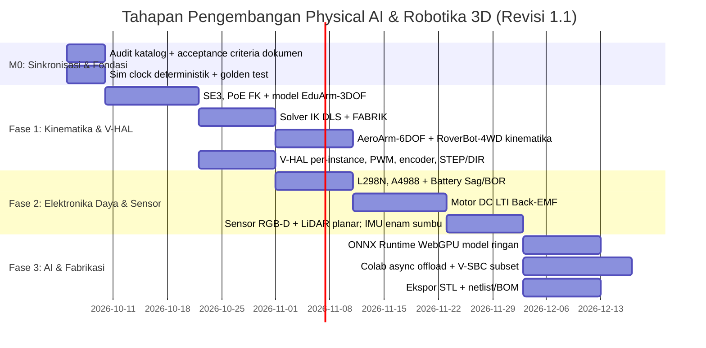

# Master Index & Dokumentasi Perencanaan TridiArduSim - Physical AI
## Peta Jalan Platform Simulasi 3D Robotika, AI Fisik & Elektronika Kerakyatan

Selamat datang di repositori dokumentasi rekayasa dan perencanaan komprehensif untuk ekspansi platform **TridiArduSim** menuju ekosistem **Physical AI & Robotika Modern**.

- **Branch Pengembangan**: `feature/physical-ai-robotics-simulation`
- **Misi Utama**: Mendemokratisasi riset dan edukasi Physical AI, Robotika, dan Elektronika Terbuka di Indonesia agar dapat diakses oleh semua lapisan masyarakat tanpa terhalang mahalnya hardware komersial (NVIDIA Jetson, Raspberry Pi, dan sensor industri).

> **Revisi 1.16 (5 Oktober 2026)** — Ditambahkan physics worker Rapier 3D WASM yang disinkronkan dengan sim-clock 5 ms, mode body off/fixed/dynamic, massa/gesekan/pantulan, collider kotak dari envelope komponen, dan constraint fixed/revolute/prismatic antar-body. `npm test` lulus **95 checks**, termasuk jatuh hingga lantai dan fixed-joint; lint terarah, TypeScript, serta production build Webpack lulus. Fisika tetap opt-in dan collider berupa aproksimasi box; browser interaksi UI belum terverifikasi di environment ini, serta kontrol motor/torsi-joint, batas joint, pembentukan link robot dari mesh, dan validasi against hardware masih terbuka. Panel ONNX lokal dan V-SBC/Gateway/I2C tetap seperti revisi sebelumnya: ONNX hanya klasifikasi input Float32 rank-4, tanpa model contoh atau deteksi; wheel NumPy/OpenCV masih mengambil CDN first run; sensor, GPIO, gateway/cloud tunnel dan kamera perlu E2E. Solder bridge elektrik, proteksi charger fisik, solver transien, dan ekspor Gerber/STEP tetap terbuka.

---

## 📚 Struktur Dokumen Perencanaan (Reading Guide)

Dokumen di dalam folder `docs/` ini disusun secara modular dan berurutan untuk memudahkan navigasi implementasi:

```
docs/
├── README.md                                  # Indeks Utama & Peta Jalan Eksekutif (Dokumen Ini)
├── 01-PRD-PHYSICAL-AI-ROBOTICS.md             # Product Requirements Document (Visi, Persona, P0/P1/P2)
├── 02-ARCHITECTURE-SYSTEM-DESIGN.md          # Architecture Design Document (Multi-Threaded Web Workers, V-HAL)
├── 03-SPECS-ROBOTICS-KINEMATICS.md            # Spesifikasi Kinematika Modern (Lynch & Park, PoE, DLS IK, FABRIK)
├── 04-SPECS-ADVANCED-ELECTRONICS-EMULATION.md # Spesifikasi Driver Motor, Elektromekanik, Baterai & Emulasi V-SBC
├── 05-DEMOCRATIZED-PHYSICAL-AI-FRAMEWORK.md   # Solusi Menembus Batasan Hardware (Jetson/RPi vs Colab & Kit < Rp 300rb)
├── 06-SOLDERING-ASSEMBLY-BEST-PRACTICES.md    # Standar Soldering IPC-A-610, Wiring AWG, Virtual Solder & Ekspor 3D
├── 07-EVALUASI-DESAIN-KOMPONEN-3D.md          # Evaluasi Jujur & Audit Skor Kemiripan Desain 3D vs Komponen Nyata
├── INVENTARIS.md                              # Audit Baseline Katalog Komponen Fisik & Elektrik
└── RENCANA.md                                 # Catatan Audit Awal ArduSim
```

---

## 🗺️ Ringkasan Eksekutif Setiap Dokumen

| Dokumen | Inti Pembahasan & Kontribusi Teknis | Tautan Langsung |
|---|---|---|
| **01. PRD (Product Requirements)** | Mengidentifikasi masalah ketiadaan akses hardware di Indonesia (biaya Jetson Rp 8–15 juta vs UMR), menetapkan prioritas fitur P0 (Kinematika & V-HAL), P1 (AI Hybrid & Elektronika Daya), P2 (Sim-to-Real Fabrikasi). | [Buka PRD](file:///Users/user/Projects/simulate/docs/01-PRD-PHYSICAL-AI-ROBOTICS.md) |
| **02. System Architecture (ADD)** | Merancang arsitektur multi-thread Web Worker: pemisahan UI Thread (Three.js/R3F), Physics Worker (Rapier3D WASM), Circuit Worker (MNA Solver), dan AI Inference Gateway dengan sinkronisasi biner TypedArray 60 FPS. | [Buka ADD](file:///Users/user/Projects/simulate/docs/02-ARCHITECTURE-SYSTEM-DESIGN.md) |
| **03. Robotics Kinematics Specs** | Penerapan teori buku *Modern Robotics* (Kevin Lynch & Frank Park): Aljabar Lie $SE(3)$, Product of Exponentials (PoE) Forward Kinematics, Jacobian Damped Least Squares (DLS), Redundansi Null-Space, dan FABRIK. | [Buka Specs Kinematika](file:///Users/user/Projects/simulate/docs/03-SPECS-ROBOTICS-KINEMATICS.md) |
| **04. Advanced Electronics Specs** | Model elektromekanik motor DC & Back-EMF, driver L298N (drop saturasi $V_{CE}$ & termal), stepper A4988/DRV8825 microstepping, model baterai Li-ion/LiPo, serta proteksi Brownout Reset (BOR). | [Buka Specs Elektronika](file:///Users/user/Projects/simulate/docs/04-SPECS-ADVANCED-ELECTRONICS-EMULATION.md) |
| **05. Democratized Physical AI** | Cetak biru menghapus ketergantungan Jetson/RPi: Virtual SBC Python (`cv2`, `rclpy`, `Jetson.GPIO`), komputasi hybrid gratis via Google Colab GPU (Tesla T4), dan cetak biru robot fisik nyata berbiaya < Rp 300.000 (ESP32-CAM + SG90). | [Buka Framework AI](file:///Users/user/Projects/simulate/docs/05-DEMOCRATIZED-PHYSICAL-AI-FRAMEWORK.md) |
| **06. Soldering & 3D Assembly** | Standar solder profesional IPC-A-610, panduan suhu & flux, manajemen kabel AWG anti-lepas, spesifikasi modul baru **Virtual Soldering Simulator**, dan ekspor file cetak 3D STL/STEP serta Gerber PCB. | [Buka Panduan Assembly](file:///Users/user/Projects/simulate/docs/06-SOLDERING-ASSEMBLY-BEST-PRACTICES.md) |
| **07. Evaluasi Desain Komponen 3D** | Penilaian ulang 31 model (34 tipe katalog): estimasi kemiripan kode/geometri rata-rata 90,4%, 25 model Tier S; render-to-photo dan toleransi CAD masih perlu divalidasi. | [Buka Evaluasi 3D](file:///Users/user/Projects/simulate/docs/07-EVALUASI-DESAIN-KOMPONEN-3D.md) |

---

## 🚀 Tahapan Implementasi Teknis (Roadmap Milestones)



> **Catatan v1.1**: (a) item lama *WebSerial Flashing Firmware ESP32* **sudah terimplementasi** — `src/lib/hardware/avrFlasher.ts` & `espFlasher.ts`; (b) *Modul Virtual Soldering* dikeluarkan dari roadmap utama menjadi proyek mandiri P2 (doc 06); (c) *URDF Parser penuh*, *Gerber*, *STEP* ditunda; (d) tahap **M0** ditambahkan karena audit menunjukkan dokumen v1.0 tidak sinkron dengan kode (katalog 11 vs 21 tipe, "MNA dinamis" vs solver DC existing, "Colab <35 ms" vs latensi realistis 60–150 ms).

---

## 🛠️ Status Lingkungan Pengembangan (Current Environment)
- **Branch Aktif**: `feature/physical-ai-robotics-simulation` (Sinkron pada Root, `frontend`, dan `backend`).
- **Frontend Stack**: Next.js 16, React 19, Three.js `r184`, React Three Fiber, Monaco Editor, Zustand, esptool-js, ONNX Runtime Web 1.30.0 (WASM/WebGPU), dan Rapier3D compat WASM 0.21.0. Physics worker menjalankan body/collision/joint primitive; mesh-specific collider dan actuator-joint dynamics belum ada.
- **Backend Stack**: Go Fiber, SQLite persistence, WebSerial protocol handler.
- **Sudah tersedia**: WebSerial flashing AVR + ESP32, ESP32-WROOM & PLC Omron CP1E, periferal dasar, interpreter .ino dan solver DC ≤256 net. Simulation clock fixed-step 5 ms, frame sync rata-rata 60 Hz, dan akses HTTP langsung dari sketch diblokir. EduArm-3DOF/AeroArm-6DOF menyediakan FK/IK; RoverBot-4WD menyediakan differential-drive. PWM mendukung Uno 8-bit dan ESP32 8–16-bit; encoder dapat membaca stepper/DC dan memicu interrupt (belum cycle-accurate). Servo/Stepper/DC dapat memetakan sudut ke joint secara kinematik tanpa torsi balik/dinamika link. A4988 memodelkan current limit, UVLO, OCP, dan RC thermal shutdown secara kuasistatik; L298N memberi drop nominal, monitor arus, clamp flyback dan thermal shutdown; motor DC mempunyai R-L/back-EMF serta integrasi 5 ms. Battery pack OCV/ESR/SoC memodelkan sag dan BOR; regulator buck-boost 3.3/5/9/12 V mengumpan balik arus masuk pada fixed-step; catu DC tetap sumber ideal. Snapshot RGB-D/LiDAR/IMU mengalir ke simulation worker dan sketch API numerik. Python subset V-SBC berjalan pada worker Pyodide; I2C ACK memerlukan alamat, jalur bus dan power yang benar, dan contoh scanner menampilkan perangkat responsif. Async AI Gateway mengirim frame kamera terpilih dan menerima action chunk joint terbatas; notebook Colab starter memakai policy hold sebagai demonstrasi protokol. Lihat INVENTARIS dan RENCANA untuk batas dukungan.
- **Masih terbuka**: perluasan Rapier ke geometri tiap mesh, motor/torsi actuator-joint dan batas joint; perluasan ONNX untuk deteksi/preprocessing khusus model dan verifikasi browser; verifikasi cloud tunnel/model aktual; browser E2E sensor/Python/I2C/gateway; regulator onboard MCU; serta validasi dinamika elektromekanik dan hardware. Runtime NumPy/OpenCV browser dan alur kamera/GPIO belum dikonfirmasi end-to-end karena worker mengambil wheel dari CDN saat first run.
- **Status Validasi kinematika (5 Oktober 2026)**: ModernRoboticsPython 1.1.1 membandingkan 10.000 pose/transform/Jacobian dan 250 target IK. Error maksimum FK posisi/orientasi `1.944e-16 m` / `5.095e-16 rad`, exp SE(3) `9.992e-16 m` / `8.017e-16 rad`, log `3.767e-14`, Jacobian `6.661e-16`; pose-DLS maksimum `9.992e-05 m` / `1.585e-05 rad`, position-DLS `9.994e-05 m`. Pada reproduksi terakhir DLS p95/max `0.271/1.777 ms` (pose) dan `0.374/3.540 ms` (position) di host uji. FABRIK lulus invariant geometri untuk 200 target reachable dan kasus unreachable. `npm test` lulus **76 checks**, termasuk recovery position-DLS dari arm lurus; lint terarah, TypeScript, dan production build Webpack lulus pada revisi ini. Perintah reproduksi ada di `frontend/README.md`/`RENCANA.md`; status ini tidak menggantikan validasi browser atau hardware.
