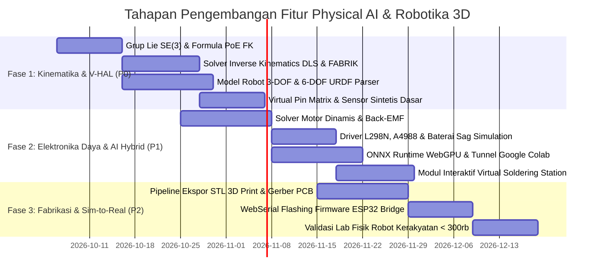

# Master Index & Dokumentasi Perencanaan TridiArduSim - Physical AI
## Peta Jalan Platform Simulasi 3D Robotika, AI Fisik & Elektronika Kerakyatan

Selamat datang di repositori dokumentasi rekayasa dan perencanaan komprehensif untuk ekspansi platform **TridiArduSim** menuju ekosistem **Physical AI & Robotika Modern**.

- **Branch Pengembangan**: `feature/physical-ai-robotics-simulation`
- **Misi Utama**: Mendemokratisasi riset dan edukasi Physical AI, Robotika, dan Elektronika Terbuka di Indonesia agar dapat diakses oleh semua lapisan masyarakat tanpa terhalang mahalnya hardware komersial (NVIDIA Jetson, Raspberry Pi, dan sensor industri).

---

## 📚 Struktur Dokumen Perencanaan (Reading Guide)

Dokumen di dalam folder `docs/` ini disusun secara modular dan berurutan untuk memudahkan navigasi implementasi:

```
docs/
├── README.md                                  # Indeks Utama & Peta Jalan Eksekutif (Dokumen Ini)
├── 01-PRD-PHYSICAL-AI-ROBOTICS.md             # Product Requirements Document (Visi, Persona, P0/P1/P2)
├── 02-ARCHITECTURE-SYSTEM-DESIGN.md          # Architecture Design Document (Multi-Threaded Web Workers, V-HAL)
├── 03-SPECS-ROBOTICS-KINEMATICS.md            # Spesifikasi Kinematika Modern (Lynch & Park, PoE, DLS IK, FABRIK)
├── 04-SPECS-ADVANCED-ELECTRONICS-EMULATION.md # Spesifikasi Driver Motor, Elektromekanik, Baterai & Emulasi V-SBC
├── 05-DEMOCRATIZED-PHYSICAL-AI-FRAMEWORK.md   # Solusi Menembus Batasan Hardware (Jetson/RPi vs Colab & Kit < Rp 300rb)
├── 06-SOLDERING-ASSEMBLY-BEST-PRACTICES.md    # Standar Soldering IPC-A-610, Wiring AWG, Virtual Solder & Ekspor 3D
├── INVENTARIS.md                              # Audit Baseline Katalog Komponen Fisik & Elektrik
└── RENCANA.md                                 # Catatan Audit Awal ArduSim
```

---

## 🗺️ Ringkasan Eksekutif Setiap Dokumen

| Dokumen | Inti Pembahasan & Kontribusi Teknis | Tautan Langsung |
|---|---|---|
| **01. PRD (Product Requirements)** | Mengidentifikasi masalah ketiadaan akses hardware di Indonesia (biaya Jetson Rp 8–15 juta vs UMR), menetapkan prioritas fitur P0 (Kinematika & V-HAL), P1 (AI Hybrid & Elektronika Daya), P2 (Sim-to-Real Fabrikasi). | [Buka PRD](file:///Users/user/Projects/simulate/docs/01-PRD-PHYSICAL-AI-ROBOTICS.md) |
| **02. System Architecture (ADD)** | Merancang arsitektur multi-thread Web Worker: pemisahan UI Thread (Three.js/R3F), Physics Worker (Rapier3D WASM), Circuit Worker (MNA Solver), dan AI Inference Gateway dengan sinkronisasi biner TypedArray 60 FPS. | [Buka ADD](file:///Users/user/Projects/simulate/docs/02-ARCHITECTURE-SYSTEM-DESIGN.md) |
| **03. Robotics Kinematics Specs** | Penerapan teori buku *Modern Robotics* (Kevin Lynch & Frank Park): Aljabar Lie $SE(3)$, Product of Exponentials (PoE) Forward Kinematics, Jacobian Damped Least Squares (DLS), Redundansi Null-Space, dan FABRIK. | [Buka Specs Kinematika](file:///Users/user/Projects/simulate/docs/03-SPECS-ROBOTICS-KINEMATICS.md) |
| **04. Advanced Electronics Specs** | Model elektromekanik motor DC & Back-EMF, driver L298N (drop saturasi $V_{CE}$ & termal), stepper A4988/DRV8825 microstepping, model baterai Li-ion/LiPo, serta proteksi Brownout Reset (BOR). | [Buka Specs Elektronika](file:///Users/user/Projects/simulate/docs/04-SPECS-ADVANCED-ELECTRONICS-EMULATION.md) |
| **05. Democratized Physical AI** | Cetak biru menghapus ketergantungan Jetson/RPi: Virtual SBC Python (`cv2`, `rclpy`, `Jetson.GPIO`), komputasi hybrid gratis via Google Colab GPU (Tesla T4), dan cetak biru robot fisik nyata berbiaya < Rp 300.000 (ESP32-CAM + SG90). | [Buka Framework AI](file:///Users/user/Projects/simulate/docs/05-DEMOCRATIZED-PHYSICAL-AI-FRAMEWORK.md) |
| **06. Soldering & 3D Assembly** | Standar solder profesional IPC-A-610, panduan suhu & flux, manajemen kabel AWG anti-lepas, spesifikasi modul baru **Virtual Soldering Simulator**, dan ekspor file cetak 3D STL/STEP serta Gerber PCB. | [Buka Panduan Assembly](file:///Users/user/Projects/simulate/docs/06-SOLDERING-ASSEMBLY-BEST-PRACTICES.md) |

---

## 🚀 Tahapan Implementasi Teknis (Roadmap Milestones)



---

## 🛠️ Status Lingkungan Pengembangan (Current Environment)
- **Branch Aktif**: `feature/physical-ai-robotics-simulation` (Sinkron pada Root, `frontend`, dan `backend`).
- **Frontend Stack**: Next.js 16, React 19, Three.js `r184`, React Three Fiber, Rapier3D WASM, Monaco Editor, Zustand.
- **Backend Stack**: Go Fiber, SQLite persistence, WebSerial protocol handler.
- **Status Validasi**: Seluruh perancangan matematis, arsitektur, dan dokumentasi telah terverifikasi dan siap ditransformasikan ke kode implementasi.
